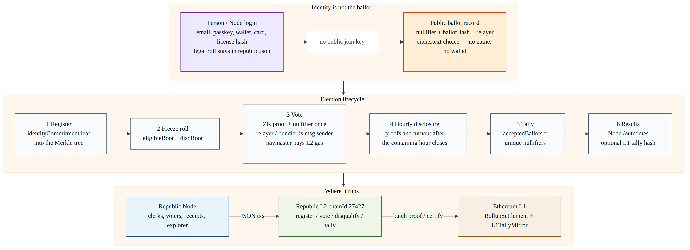

# zk-voting

**NOT FOR PROFIT** — civic public good. Not a commercial product. See [`NOT_FOR_PROFIT.md`](./docs/NOT_FOR_PROFIT.md).

> **Monorepo layout (2026-10-25):** this folder (`demo/`) holds the app. The Solidity package `smart-contracts/` lives at the repository root ([`../smart-contracts/`](../smart-contracts)); references below to `smart-contracts/` mean that folder, and the landing page lives in [`../site/`](../site). Commands in this README run from `demo/`.

A monorepo for a **zero-knowledge, Ethereum-settled voting and polling system** that anyone can self-host, fork, and rebrand to learn the will of the people. Default product name: **zk-voting**, the same as the repo name, until an administrator renames it.

> **Branding is yours.** `zk-voting` is only the default name. A fork for a city, union, school, cooperative, or survey group should show its own name. Today officers edit the public home page and contract pins at `/office/site`, and environment variables always win over values saved there. A full branding configuration (name, logo, colors, email sender) is on the roadmap. Earlier versions of this README called the product "Republic"; some identifiers keep that name for compatibility (`republic.json`, `REPUBLIC_NODE_URL`, the `republic` Compose network, Solidity names such as `RepublicEntryPoint`).

## Quickstart

You need Docker with Compose v2. Full guide: [Docker Compose quickstart](./docs/self-hosting/docker-compose.md).

```bash
git clone https://github.com/<your-org>/zk-voting.git
cd zk-voting
cp .env.example .env          # set VOTE_FQDN, SUPER_ADMIN_EMAIL, and the secrets it lists
docker compose up -d --build
curl -fsS http://127.0.0.1:3000/health
```

Then open `http://127.0.0.1:3000`, go to **Register**, and claim the administrator handle (`ADMIN_HANDLE`, default `admin`) right away: [First launch](./docs/self-hosting/first-launch.md).

Private by default: [`docker-compose.tailscale.yml`](./docker-compose.tailscale.yml) runs the same stack behind a `tailscale/tailscale:stable` sidecar with HTTPS on your tailnet and no public ports.

## Self-hosting docs

The same guides are served by every node at **`/docs`** and live in [`docs/self-hosting/`](./docs/self-hosting/README.md).

| Install | Upgrade |
| --- | --- |
| [Overview](./docs/self-hosting/README.md) | [Upgrading and release channels](./docs/self-hosting/upgrading.md) |
| [Requirements](./docs/self-hosting/requirements.md) | [Backups](./docs/self-hosting/backups.md) |
| [Docker Compose quickstart](./docs/self-hosting/docker-compose.md) | [Rollback](./docs/self-hosting/rollback.md) |
| [Coolify](./docs/self-hosting/coolify.md) | [Rolling updates](./docs/self-hosting/rolling-updates.md) |
| [Dokploy, CapRover, plain Compose](./docs/self-hosting/other-platforms.md) | |
| [Tailscale sidecar](./docs/self-hosting/tailscale.md) | |
| [Configuration reference](./docs/self-hosting/configuration.md) | |
| [First launch](./docs/self-hosting/first-launch.md) | |
| [Health checks](./docs/self-hosting/health-checks.md) | |

Day-two operations, keys, and incident handling: [`docs/OPERATOR.md`](./docs/OPERATOR.md).

## Positioning

[vote.makerdao.com](https://vote.makerdao.com) is the sample for this voting experience. That portal was built for MakerDAO's own governance. zk-voting makes the same kind of vote generic and self-hosted, like Discourse, so anybody can run their own vote. Maker executive votes are binding: when they pass, the underlying contracts execute the change. A zk-voting outcome is non-binding sentiment. The verifiable result is stored on chain, and passing a vote does not auto-execute anything. Operators also get more oversight and admin than that portal: an approval chain of platform and jurisdiction officers, public disqualification reason codes, and an independent auditor. Full note: [Inspiration: vote.makerdao.com](./implementation.md#inspiration-votemakerdaocom).

This repository holds two tightly coupled pieces of software (and the circuits, L2, and packages that bind them):

1. A **Node application**: the product surface for voters, election officials, and public observers (`apps/node`).
2. A **`smart-contracts/`** package: Solidity for Ethereum that registers voters, opens ballots, records (or commits to) votes with zero-knowledge proofs, and **enforces disqualification** so that a person who is on the roll can still be barred from a given election for jurisdiction-defined reasons.

The same **Solidity** is meant to run **on Ethereum mainnet (L1)** and on any EVM venue a jurisdiction chooses (Lighter, other L2s, Foundry Anvil). Cheap, high-volume civic activity in *this* repo lands on **zk-voting L2** (this repo’s civic JSON sequencer + prover, **chainId 27427**), in the same family of design as [Lighter](https://lighter.xyz): prove the operations, settle proofs and state to Ethereum. Canonical law, final tallies, and dispute-grade records can live on L1, or be mirrored there.

zk-voting L2 **as implemented** is an application-specific civic sequencer (JSON transactions: register / vote / disqualify / tally / userop). It is **not** a general-purpose EVM and it does **not** proxy to Anvil. Portable EVM bytecode still deploys to Anvil, Ethereum L1, Lighter’s EVM surface, and other EVM L2s. Executing that bytecode *on* 27427 is **Future**.

**Status:** this repository is an **implemented monorepo**. Circuits, shared packages, Foundry contracts, Node app, civic L2, and operator docs are in-tree. `test/unstable` is the development line. `master` is production only. **Forking is intentional:** a jurisdiction runs its own Node and pins one shared `ElectionFactory` — see [Intentional forking](#intentional-forking).

How to read this README:

- **Product intent** (privacy, disqualification, roles) is the spec for what zk-voting is for.
- **Implemented today** (status table, how to run, Node/L2 sections) must match the tree. If those paragraphs lie, this file is overdue.
- **Future** work is labeled. [`docs/ARCHITECTURE.md`](./docs/ARCHITECTURE.md) is the package map and Solidity/circuit interface contract.

---

## Not for profit

This software is **not a commercial product**. It exists to protect and preserve a republic driven by democracy: the people vote for representatives, and those representatives vote. A city, county, state, nation, union, cooperative, or (if a jurisdiction demanded it) a shareholder meeting should be able to run a binding election with **public verifiability** and **private ballots**.

- There is **no token**. There is **no paid tier**. There is **no vendor lock-in**.
- Nobody is to make money off this repository. Jurisdictions may run it **at cost** (hosts, paymaster gas, paper notice).
- Voter data is not a product. Gas sponsorship is not a fee.
- Every document in this repo carries a visible **NOT FOR PROFIT** label. Solidity files carry `// NOT FOR PROFIT — civic public good, not a commercial product.`

If you want to get rich, this is the wrong repository. Full charter: [`NOT_FOR_PROFIT.md`](./docs/NOT_FOR_PROFIT.md). License: AGPL-3.0-or-later.

---

## Table of contents

- [Quickstart](#quickstart)
- [Self-hosting docs](#self-hosting-docs)
- [Positioning](#positioning)
- [Not for profit](#not-for-profit)
- [Purpose](#purpose)
- [Who it is for](#who-it-is-for)
- [What “zero-knowledge voting” means here](#what-zero-knowledge-voting-means-here)
- [Current status](#current-status)
- [Monorepo layout](#monorepo-layout)
- [How to run](#how-to-run)
- [Operating cost estimate](#operating-cost-estimate)
- [Copy-paste credentials](#copy-paste-credentials)
- [Intentional forking](#intentional-forking)
- [Voting subdomain](#voting-subdomain)
- [Node application](#node-application)
- [Smart contracts](#smart-contracts)
- [Circuits](#circuits)
- [Shared packages](#shared-packages)
- [Chains: Ethereum L1, zk-voting L2, and Lighter](#chains-ethereum-l1-zk-voting-l2-and-lighter)
- [Registration](#registration)
- [Eligibility, disqualification, and due process](#eligibility-disqualification-and-due-process)
- [Ballots and “voting on aspects”](#ballots-and-voting-on-aspects)
- [Election types and jurisdictions](#election-types-and-jurisdictions)
- [Roles](#roles-and-permissions)
- [End-to-end flows](#end-to-end-flows)
- [Election workflow diagram](#election-workflow-diagram)
- [Privacy, coercion resistance, and public verifiability](#privacy-coercion-resistance-and-public-verifiability)
- [How voters’ privacy is protected](./docs/how_voters_privacy_is_protected.md)
- [Security and threat model](#security-and-threat-model)
- [What this system will not do](#what-this-system-will-not-do)
- [Development](#development)
- [Roadmap](#roadmap)
- [Glossary](#glossary)
- [Related work](#related-work)
- [Legal note](#legal-and-policy-note)

---

## Purpose

Democratic processes still depend on a small set of trusted operators: who is on the roll, who was turned away, whether a ballot was counted, and whether the published result matches the ballots. Paper and proprietary machines can work. They do not, by themselves, let a voter, a losing candidate, or a court **verify** those claims without re-trusting the same operators.

This project exists to make those claims **checkable**:

- A person can **register to vote** for a jurisdiction (a city, a district, a nation, a private body that still wants an election-grade process).
- That person can **cast a ballot** on one or more questions (“aspects”) in an election.
- The public can verify that **only eligible people voted, at most once**, and that the **tally is the sum of those ballots**.
- Election officials can still **disqualify** a registered person when the law or the body’s rules require it (death, non-residency, duplicate identity, court order, already voted, and other coded reasons). Disqualification is an on-chain, auditable state change — not an invisible database flag.
- A voter’s **choice** is not published. Eligibility and “this person already voted / is barred” are.

The Node app is how humans do that work. The contracts are how Ethereum (L1 and L2) enforces it.

---

## Who it is for

| Audience | What they do here |
| --- | --- |
| **Voters** | Register, see whether they are eligible or disqualified, cast a ballot, keep a receipt that does not reveal their choice. |
| **Election officials / clerks** | Stand up an election, define the roll and the questions, apply and reverse disqualifications, publish results. |
| **Jurisdictions** | A government, a county, a nation, a union, a board — any body that needs a roll, a ballot, and a binding result. **Fork this Node** for the clerk desk and public pages; pin the one shared factory. |
| **Candidates and observers** | Watch the public state: how many registered, how many disqualified (and on what coded grounds), hourly published ballot counts, the proven tally. |
| **Auditors and courts** | Reconstruct the election from chain data, proofs, and the Node’s published artifacts without trusting a vendor’s black box. |

The product is **not** limited to national general elections. The same machinery should cover a municipal referendum, a legislative internal vote, or a professional body’s election, as long as someone is willing to run the jurisdiction and accept the legal consequences.

---

## What “zero-knowledge voting” means here

Zero-knowledge is used so that the chain can check **facts about a voter** without putting the **ballot** (and, where the jurisdiction requires it, the voter’s civil identity) in the clear.

The properties we are aiming for:

1. **Eligibility.** A vote proof is only valid if the prover is in the current eligible set for that election.
2. **Disqualification.** Being registered is not enough. If the person is on the disqualification set for that election (or that question), the same circuits must reject the vote.
3. **One counted ballot per eligible person** (or one per question, depending on the election rules), via nullifiers. Each nullifier is accepted **once**. A second ballot — including a new ciphertext — is rejected (`NullifierUsed`). Double voting is impossible. Voters may change their mind privately on the ballot form **before** submit.
4. **Hidden choice.** The option selected is not an on-chain plaintext field anyone can read from the transaction.
5. **Public tally.** After the poll closes, anyone can check a proof that the published totals match the accepted ballots.
6. **Public process.** Registration events, disqualification actions, poll parameters, and final tallies are attributable to known roles (jurisdiction, clerk, registrar).

Zero-knowledge does **not** mean “nobody is in charge.” Someone still maintains the legal roll. ZK means that once that roll and the disqualification list are committed, **counting and eligibility checks are not a second trust sink**.

Privacy construction (implementation): a person uniquely identifies with **email** (up to 5, exactly one primary), an **Ethereum wallet** (signature), a **smart-card reader**, a **driver’s license or passport** (hashed; no images or full numbers stored), or a **passkey** (up to 5; any of them can sign in). Several ETH addresses may be verified internally; only one is active. **Every sign-in path uses email MFA via AWS SES** (primary inbox by default). Profile setup includes a **vote PIN** (4–8 digits; scrambled phone keypad at ballot submit; forgot PIN via the same email MFA). WebAuthn **PRF** derives a secp256k1 smart-account key **and**, under a separate domain, `(identityTrapdoor, nullifierSecret)`. The Merkle leaf is the identity commitment, never the active wallet address. The vote transaction is submitted by a **bundler**; the paymaster pays L2 gas. Public dashboards publish vote proofs **once an hour**, after that hour closes, so a person leaving a voting office cannot be matched to a live jurisdiction tick. See [Person identity](./docs/IDENTITY.md), [Passkeys](./docs/PASSKEYS.md), and [ARCHITECTURE](./docs/ARCHITECTURE.md).

---

## Current status

Code is **present** in this monorepo. Local **unit tests** use Foundry `MockVerifier` until Poseidon + a real Groth16 ceremony exist. The **first proving path is in progress**: compile / untrusted local setup / export scripts are in-tree. That is not a production ceremony.

| Area | State |
| --- | --- |
| This README | Product intent + honest stack (must match the tree) |
| [`docs/ARCHITECTURE.md`](./docs/ARCHITECTURE.md) | Implemented map + Solidity/circuit interfaces; **Future** labeled |
| [`docs/THREAT_MODEL.md`](./docs/THREAT_MODEL.md) | Adversary map for election identity and L1 certification |
| Node application (`apps/node`) | Express 4 API + **vanilla JS** pages in `public/`. JSON store `apps/node/data/republic.json`. **No Vite, no React, no SQLite.** `system_actions.sh` |
| `smart-contracts/` | In-tree (Solidity 0.8.24, Foundry `via_ir = true`: factory, registries, inbox, `Tally.sol`, account, L2 settlement) |
| Circuits (`circuits/`) | In-tree. Vote hasher is Poseidon(2). Groth16 fixture is an **untrusted** Vote(4) proof. Ceremony **not done**. Unit tests still use MockVerifier. |
| Proving path | **In progress** — `npm run circuits:status` / `compile` / `setup` / `export` / `prove`. Untrusted local ptau only. `MockVerifier` still default for `forge test`. |
| Shared packages | `@zk-voting/types`, `proof-helpers`, `chain-client` |
| zk-voting L2 (`l2/`) | Civic JSON sequencer + prover, chainId **27427**, JSON-RPC **:8546**, L1 `RollupSettlement`. **Not** an Anvil EVM proxy |
| Block explorer | Node `/explorer` over `l2-chain.json` + ingest API; see [`docs/BLOCK_EXPLORER.md`](./docs/BLOCK_EXPLORER.md) |
| Passkeys | WebAuthn PRF helper; demo address is `republic-local-address` (not production secp256k1). [`docs/PASSKEYS.md`](./docs/PASSKEYS.md) |
| Person identity | Passkey / Web3 / smart card / email / civic ID; vote PIN at ballot submit; one active ETH address. [`docs/IDENTITY.md`](./docs/IDENTITY.md) |
| Tally that opens ballots | **Demo slice in-tree.** `tallyScheme=opens_ballots` encrypts choices to a Feldman t-of-n P-256 public key (**NON-PRODUCTION**). `t` proved partials open envelopes; `t-1` cannot. Invented `counts[]` are rejected. Homomorphic vs mixnet aggregation is not selected ([`docs/TALLY_GUARDIANS.md`](./docs/TALLY_GUARDIANS.md)). Legacy `sum_only` still allows any partition of `acceptedBallots`. Not MACI. |
| Coercion slice | One accepted nullifier + hash-only receipts (not MACI, not last-vote-counts). |
| Independent auditor | `tools/auditor` + [`docs/AUDITOR.md`](./docs/AUDITOR.md); no Node private DB |
| Ballot types | UI: `YES_NO`, `SINGLE_CHOICE`, `MULTI_CHOICE`, `RANKED` (IRV), `MEASURE`, `ARTICLE`. |
| Voter info pages | `/elections/:id/info` and `/elections/:id/info/:questionId/:optionId` (vanilla JS) |
| Accessibility | WCAG 2.2 AA axe on the voter, registered, admin, and public shells. [`docs/ACCESSIBILITY.md`](./docs/ACCESSIBILITY.md) |
| Bot API | Public `/api` docs, OpenAPI, and `llms.txt`. Personal keys on `/me`: read-only, voter, or officer; expiration `7d` / `30d` / `90d` / `180d` / `365d` / `never`. The secret is shown once. [`docs/BOT_API.md`](./docs/BOT_API.md) |
| Results page `/elections/:id/results` | Linked from explorer / back-office / voter SPA |
| Token polls (`POLLS_ENABLED`) | **Phase 1, flag off by default.** One host ERC-20 (`VOTING_TOKEN_ADDRESS`, Ethereum mainnet chain id 1) weights **signal** polls (plurality + IRV). Read-only balances. Weight is the minimum from the vote block through close. No identity layer. Not binding. [`docs/POLLS.md`](./docs/POLLS.md). L1 result mirror skipped (follow-up). |
| Production deployment | None on `master` until a jurisdiction pins addresses. `master` is reserved for it. |
| Intentional Node forks | Documented. Copy [`.env.example`](./.env.example), publish the Node at a voting subdomain (`VOTE_FQDN`, e.g. `vote.domain.tld`), pin the shared factory / inbox / verifier, do not `DeployLocal` per city. |
| Election workflow diagram | Informational PNG: register → freeze → vote (nullifier / relayer) → hourly disclosure → tally → results. [`docs/images/election-workflow.png`](./docs/images/election-workflow.png); source [`docs/diagrams/election-workflow.mmd`](./docs/diagrams/election-workflow.mmd). |

---

## Monorepo layout

Current layout (names can still move slightly; the invariants will not).

```text
zk-voting/
  README.md                    ← you are here (spec + how to run)
  voting_cost_estimate.md      host / L2 / L1 / SES cost ranges (at cost)
  how_voters_privacy_is_protected.md  commander privacy brief (design vs demo)
  NOT_FOR_PROFIT.md
  LICENSE                      AGPL-3.0-or-later
  CONTRIBUTING.md
  system_actions.sh            host/operator menu
  package.json                 npm workspaces
  docker-compose.yml           Node + L2 host path
  docs/
    ARCHITECTURE.md            implemented map + Solidity/circuit interfaces
    OPERATOR.md                host + forked Node env
    BLOCK_EXPLORER.md
    PASSKEYS.md
    IDENTITY.md
    L2.md
    AUDITOR.md                 independent export + verify (no Node private DB)
  apps/
    node/                      Express API + vanilla JS pages (public/)
  packages/
    types/                     JSDoc: ElectionParams, VoteEnvelope, Block, Jurisdiction
    proof-helpers/             publicInputs [root, disqRoot, nullifier, ballotHash, electionId]
    chain-client/              getFactory, createElection, submitVote (viem or eth_call)
  smart-contracts/             Foundry, Solidity 0.8.24, via_ir = true
    src/
    test/                      unit, fuzz, invariant
    script/                    DeployLocal, DeployL1, DeployL2, CreateElection
  circuits/                    vote.circom, tally.circom, identity.circom, HASH_SCHEME.md
  l2/                          civic JSON sequencer, prover, genesis (chainId 27427, :8546)
  tools/auditor/               CLI: export public artifacts, verify sum/invariants
```

Invariants:

- **One repo** for the voting product, the Node host, the contracts, the circuits, and the L2.
- **`smart-contracts/`** is the Solidity home. It is not buried inside the Node app.
- The Node app talks to those contracts. It does not become a second, private source of election truth.

---

## How to run

Operator narrative: [`docs/OPERATOR.md`](./docs/OPERATOR.md). Branch policy: work on **`test/unstable`**; **`master`** is production. Expected host, disk, L1, SES, and capacity ranges: [`voting_cost_estimate.md`](./docs/voting_cost_estimate.md) (jurisdictions **at cost**; **NOT FOR PROFIT**).

### Foundry tests (`smart-contracts/`)

Requires [Foundry](https://book.getfoundry.sh/) (`foundryup`). solc **0.8.24**, optimizer on, **`via_ir = true`**, fuzz 256 runs (`foundry.toml`).

```bash
cd smart-contracts
forge test --via-ir
forge test --via-ir --fuzz-runs 256
forge test --via-ir --match-path test/invariant/*

# from repo root
npm run test:contracts
npm run test:fuzz
npm run test:invariant
```

Tests must pass with `MockVerifier`. Invariants include: a nullifier is **accepted at most once** (a second ballot, including a new ciphertext, reverts; double voting is impossible); no vote outside `[startTime, cutoffTime)`; no vote if `!rollFrozen`; `sum(counts) == acceptedBallots` after tally; factory clones do not share nullifier storage. See ARCHITECTURE.

Non-mock local deploy (fail closed until a VK is installed):

```bash
REPUBLIC_PROVING_PATH=1 forge script script/DeployLocal.s.sol --rpc-url http://127.0.0.1:8545 --broadcast
```

### Circuits (proving path in progress)

Circom 2 + snarkjs. Local powers-of-tau is **untrusted**. Exact commands:

```bash
npm run circuits:status
npm run circuits:verify     # committed untrusted Vote(4) proof, or fails if keys are missing
npm run circuits:smoke      # regenerate that fixture (circom + snarkjs; not a ceremony)
npm run circuits:compile    # circom vote.circom (Vote 20) + tally.circom
npm run circuits:setup      # UNTRUSTED ptau + groth16; zkeys gitignored
npm run circuits:export     # circuits/build/*_Groth16Verifier.sol — does not overwrite VoteVerifier.sol
npm run circuits:prove      # demo Poseidon witness + groth16 verify
```

Hash versions: [`circuits/HASH_SCHEME.md`](./circuits/HASH_SCHEME.md). Poseidon is wired. The ceremony is not.

### Node (`apps/node`)

```bash
npm install
npm run dev                 # node --watch apps/node (Express + public/)
npm run start               # long-lived process for system_actions.sh
npm test -w apps/node
./system_actions.sh health  # GET http://127.0.0.1:3000/health
```

Details: [`apps/node/README.md`](./apps/node/README.md). Local store: JSON under `apps/node/data/` (gitignored). **Not SQLite.** The UI is vanilla JS in `apps/node/public/` (no Vite, no React).

Docker Compose (Node + L2 sequencer + prover), from the repo root. Credentials are one paste — [Copy-paste credentials](#copy-paste-credentials):

```bash
cp .env.example .env          # or paste the credentials block into .env
docker compose up -d --build
curl -fsS http://127.0.0.1:3000/health
```

See [`.env.example`](./.env.example) and [`docs/OPERATOR.md`](./docs/OPERATOR.md). Forked hosts pin the shared factory in that same file — [Intentional forking](#intentional-forking).

Coolify rolling update: old and new containers share `node-data` and `l2-data` on one host. A standby container stays healthy (`ok: true`, `"mode":"standby"`) and does not write until it holds the lease. Healthchecks must not require `mode=active`. Archive is on by default; only the lease holder prunes. L1 contracts (`SETTLEMENT_ADDRESS`, `VERIFIER_ADDRESS`, `L1_TALLY_MIRROR_ADDRESS`, `L1_SETTLEMENT_ADDRESS`, `ELECTION_FACTORY_ADDRESS`, `BALLOT_INBOX_ADDRESS`) are deployed once — `npm run deploy:l1 -- --check` — and containers only read those addresses. Settings: [`docs/ROLLING_UPDATES.md`](./docs/ROLLING_UPDATES.md).

### zk-voting L2 (sequencer + prover)

```bash
npm run l2:sequencer        # node l2/sequencer/index.mjs   JSON-RPC :8546
npm run l2:prover           # node l2/prover/index.mjs
./l2/bin/start-local.sh     # both
```

Genesis **chainId 27427**, one sequencer. The producer wakes every ~2s and, by default, seals a block only when there is a transaction, when the disclosure hour closes, or once an hour (`L2_SKIP_EMPTY_BLOCKS=1`, `L2_HEARTBEAT_SECONDS=3600`). A second sequencer on the same data directory stays standby and does not seal that heartbeat block. Civic JSON transactions (not an Anvil EVM proxy). Settlement: L1 `RollupSettlement.submitBatch` when `L1_RPC`, `SETTLEMENT_ADDRESS`, and `L1_CHAIN_ID` are configured and the address has code; otherwise mock proofs under `l2/data/proofs/`, or fail closed if `L1_RPC` is set but the address is missing. The prover never deploys. Voters do not pay gas. [`docs/L2.md`](./docs/L2.md). After Node tally, certify the **tally hash** on Ethereum when `L1_RPC` / `L1_TALLY_MIRROR_ADDRESS` / `L1_PUBLISHER_PRIVATE_KEY` are set; unset env is a no-op. [`docs/OPERATOR.md`](./docs/OPERATOR.md).

```bash
export L2_RPC_PORT=8546
export REPUBLIC_CHAIN_ID=27427
# Civic sequencer (implemented):
export REPUBLIC_L2_RPC_URL=http://127.0.0.1:8546
# Foundry Anvil for Solidity (optional contract path), default in chain-client:
export REPUBLIC_RPC_URL=http://127.0.0.1:8545
```

`@zk-voting/chain-client` still defaults `REPUBLIC_RPC_URL` to Anvil **:8545**. Point `CHAIN_RPC` at Anvil only when `BallotInbox` is actually deployed there. Do not treat `:8545` as the civic sequencer.

### Block explorer

With the Node up: open `/explorer`. Backend is the JSON log `apps/node/data/l2-chain.json` (Node writes + sequencer `POST /api/explorer/ingest`). API: `GET /api/explorer/blocks`, `/api/explorer/blocks/:n`, `/api/explorer/txs/:hash`, `GET /api/explorer/disclosure`, plus search / nullifier / per-election. Public election snapshot: `GET /api/elections/:id/summary` (disclosed turnout, last closed hour, countdown; `resultsUrl` only after a certified tally — this repo does not invent a winner here). Visible: commitments, nullifiers, ballot **hashes**, reason codes, tallies, batches. Hidden: choices, civil names, evidence files, trapdoors. Vote rows and public turnout wait until the hour that contained the vote has closed. [`docs/BLOCK_EXPLORER.md`](./docs/BLOCK_EXPLORER.md).

### Passkeys and person identity

A person identifies with **email** (up to 5, one primary), an **Ethereum wallet**, a **smart-card reader**, a **driver’s license or passport**, or a **passkey** (up to 5). Many Ethereum addresses can be verified internally; **exactly one** is active. Sign-in completes with **email MFA (AWS SES)** to the primary inbox by default. Profile setup includes a **vote PIN** (4–8 digits; scrambled phone keypad at ballot submit; forgot-PIN via the same email MFA). The vote Merkle leaf is still the identity commitment. [`docs/IDENTITY.md`](./docs/IDENTITY.md).

Browser WebAuthn (`residentKey`, `extensions.prf`). PRF → HKDF wraps a seed in IndexedDB. **Today** `passkey-wallet.js` labels the derived account `republic-local-address` (no secp256k1 in that helper). **Future:** wrap/derive a real secp256k1 smart-account key; UserOps bundled; `RepublicPaymaster` sponsors register/vote on an EVM. Never display a mnemonic. [`docs/PASSKEYS.md`](./docs/PASSKEYS.md).

### Independent auditor

Public artifacts only. Does **not** open the Node private DB. Docs: [`docs/AUDITOR.md`](./docs/AUDITOR.md).

```bash
npm run auditor -- fixture
npm run auditor -- verify --file bundle.json
npm run test:auditor
# from a running Node (public HTTP):
node tools/auditor/cli.mjs export-node --base http://127.0.0.1:3000 --election 1 --out bundle.json
```

### Host actions

```bash
./system_actions.sh              # interactive menu
./system_actions.sh 1            # pull + npm run dev
./system_actions.sh 2 my-feature # feature/* from test/unstable
./system_actions.sh 3            # merge feature/* into test/unstable
./system_actions.sh 4            # merge test/unstable → master (type MERGE)
./system_actions.sh status
./system_actions.sh deploy-dev   # pull test/unstable, install, build, restart
./system_actions.sh deploy-prod  # pull master (confirms first)
```

---

## Operating cost estimate

Commander-facing ranges (L2 hosts, `/data` disk, L1 proof gas, how many people can vote, AWS SES/S3, hourly results): [`voting_cost_estimate.md`](./docs/voting_cost_estimate.md). **NOT FOR PROFIT** — jurisdictions run at cost; voters pay nothing.

## Copy-paste credentials

**NOT FOR PROFIT.** Production secrets stay out of git. `.env` is gitignored. Compose interpolates this file into the Node / L2 / prover containers.

Simple deploy:

```bash
cp .env.example .env
# or paste the block below into .env at the repository root
docker compose up -d --build
curl -fsS http://127.0.0.1:3000/health
```

Paste **as-is** for a local demo (empty keys, mock L2 proofs, no SES). For a public jurisdiction Node, fill the lines in the table after the block. Do not commit the filled file. Do not paste real keys into issues or chat.

```env
# NOT FOR PROFIT — civic public good, not a commercial product.
# cp .env.example .env && docker compose up -d --build

# --- this host ---
ZK_VOTING_PORT=3000
CHAIN_ID=27427
CHAIN_RPC=http://l2:8546
# Public voting hostname. Empty here = local demo.
# A jurisdiction creates this name in DNS (example: vote.domain.tld).
VOTE_FQDN=
RP_ID=localhost
WEBAUTHN_ORIGINS=http://localhost:3000,http://127.0.0.1:3000
PUBLIC_BASE_URL=
ADMIN_HANDLE=admin
# Platform super admin contact email. Empty = leave the stored address.
# Invalid refuses to start. Runtime only (not baked into the image).
SUPER_ADMIN_EMAIL=
DISCLOSURE_INTERVAL_SECONDS=3600
ALLOW_DEV_LOGIN=
ALLOW_SMART_CARD_MOCK=
ALLOW_CIVIC_ID_MOCK=

# --- AWS SES (email MFA, Terms PDF, sign-in terms notice, /feedback). Empty = local demo, no outbound mail. ---
SES_FROM_ADDRESS=
AWS_REGION=
AWS_ACCESS_KEY_ID=
AWS_SECRET_ACCESS_KEY=
SES_CONFIGURATION_SET=
SES_ENDPOINT=
SES_DRY_RUN=
REQUIRE_EMAIL_MFA=
FEEDBACK_RATE_WINDOW_SECONDS=3600
FEEDBACK_MIN_SUBMIT_MS=3000
FEEDBACK_MAX_BODY_BYTES=16384
TRUST_PROXY=

# --- civil credential connector. Empty secret = manual officer review. ---
CREDENTIAL_PROVIDER_SECRET=
CREDENTIAL_PROVIDER_ID=manual

# --- locked receipt / official-outcome PDFs. Empty = Node mints a file on disk. ---
RECEIPT_PDF_SECRET=

# --- L2 sequencer → Node explorer ingest. Empty in production refuses ingest. ---
EXPLORER_INGEST_SECRET=

# --- pin the ONE shared deploy (do not DeployLocal again for a new city) ---
ELECTION_FACTORY_ADDRESS=
BALLOT_INBOX_ADDRESS=
VERIFIER_ADDRESS=
RELAYER_PRIVATE_KEY=

# --- Republic L2 ---
L2_RPC_PORT=8546
L2_BATCH_SIZE=4
L2_SKIP_EMPTY_BLOCKS=1
L2_HEARTBEAT_SECONDS=3600
DEV_MOCK_PROOF=true
REPUBLIC_NODE_URL=http://node:3000

# --- optional L1 (prover settlement + Node tally-hash). Empty = no-op. ---
L1_RPC=
SETTLEMENT_ADDRESS=
PRIVATE_KEY=
L1_TALLY_MIRROR_ADDRESS=
L1_PUBLISHER_PRIVATE_KEY=
L1_SETTLEMENT_ADDRESS=
L1_CHAIN_ID=

# --- L2 hourly attic (S3 or R2). On by default. Empty bucket does not delete. ---
ARCHIVE_ENABLED=1
ARCHIVE_COMPRESS=1
ARCHIVE_S3_BUCKET=
ARCHIVE_S3_ENDPOINT=
ARCHIVE_S3_REGION=auto
ARCHIVE_S3_ACCESS_KEY_ID=
ARCHIVE_S3_SECRET_ACCESS_KEY=
ARCHIVE_HOT_WINDOW_HOURS=2
ARCHIVE_EXPLORER_SNAPSHOT=0
```

| Fill this | When |
| --- | --- |
| `VOTE_FQDN` | The subdomain this body creates for voting, e.g. `vote.domain.tld`. That hostname is the voting authority (passkeys, browser origin, official links). Empty on a local demo. |
| `RP_ID`, `WEBAUTHN_ORIGINS`, `PUBLIC_BASE_URL` | Optional once `VOTE_FQDN` is set. The Node derives the relying party, the `https://` origin, and the official base URL from that hostname. Set `RP_ID` only to pin a different public parent hostname. |
| `ADMIN_HANDLE` | Handle of the seeded `platform_super_admin` when none exists. Default `admin` |
| `SUPER_ADMIN_EMAIL` | Contact email written onto that person at process start. Empty leaves the stored address. The active writer applies it on every boot. `/feedback` delivers there |
| `SES_FROM_ADDRESS`, `AWS_REGION` | Email MFA, Terms PDF mail (on accept, and once per member per plain-text hash on sign-in), and `/feedback` to the platform super admin. Leave AWS keys empty to use the host IAM role; otherwise set `AWS_ACCESS_KEY_ID` / `AWS_SECRET_ACCESS_KEY`. `SES_DRY_RUN=1` captures feedback and does not call SES. `PUBLIC_BASE_URL` is the origin of the sign-in terms link. `FEEDBACK_RATE_WINDOW_SECONDS` defaults to `3600` and cannot be shorter (one accepted note per IP per hour) |
| `ELECTION_FACTORY_ADDRESS`, `BALLOT_INBOX_ADDRESS`, `VERIFIER_ADDRESS` | Pin the **shared** factory / inbox / verifier. Env wins over `/office/site`. Do not run `DeployLocal` again for a new city |
| `RELAYER_PRIVATE_KEY` | This host’s relayer (factory create + vote relay). Never a mainnet key in git |
| `CREDENTIAL_PROVIDER_SECRET` | Optional later DMV / eID webhook. Unset = officers review credentials by hand |
| `RECEIPT_PDF_SECRET` | Stable HMAC for locked PDFs across restarts. Unset = Node writes `$DATA_DIR/receipt-pdf.secret` |
| `EXPLORER_INGEST_SECRET` | L2 sequencer ingest of `/api/explorer/ingest`. Unset in production refuses ingest (explorer is not a second tally) |
| `L1_RPC`, `L1_TALLY_MIRROR_ADDRESS`, `L1_PUBLISHER_PRIVATE_KEY` | Certify tally hashes on Ethereum. Unset = tally still works (`skipped`) |
| `SETTLEMENT_ADDRESS`, `PRIVATE_KEY` | L2 prover posts `RollupSettlement.submitBatch`. **Not** the Node `L1_PUBLISHER_PRIVATE_KEY` |
| `ARCHIVE_ENABLED`, `ARCHIVE_S3_*`, `ARCHIVE_COMPRESS` | Hourly L2 attic to S3/R2. Default on and gzip. Empty bucket and no `file://` sink warns and does not prune. `ARCHIVE_ENABLED=0` turns it off |
| `L2_SKIP_EMPTY_BLOCKS`, `L2_HEARTBEAT_SECONDS` | Default: seal on transactions, hour close, and one empty heartbeat per hour. `L2_SKIP_EMPTY_BLOCKS=0` seals every ~2s |
| `ALLOW_DEV_LOGIN` | Local fallback only. Must stay empty on `master` |
| `CHAIN_RPC` | Empty = JSON-only demo (no factory call). Compose default `http://l2:8546` is the civic sequencer |

Committed template (same keys): [`.env.example`](./.env.example). Operator narrative: [`docs/OPERATOR.md`](./docs/OPERATOR.md).

---

## Intentional forking

Forking this repository is **the intended way** a jurisdiction runs zk-voting. A city, county, union, cooperative, or other body copies the **Node** (voter pages, clerk desk, CMS, host) and pins the **one shared** `ElectionFactory`, `BallotInbox`, and verifier. That is how there is no vendor lock-in: you host your clerk desk; you do not pay a SaaS; you do not get a private factory.

This is a GitHub / host fork of **this** Node. It is not a fork of MACI, Semaphore, or Lighter (see [Related work](#related-work)).

**NOT FOR PROFIT** still applies to every fork. License is AGPL-3.0-or-later: if you run a modified Node as a network service, you must offer the corresponding source. Do not sell the software, wrap it in a token, or reuse chainId **27427** for a commercial L2 ([`docs/L2.md`](./docs/L2.md)).

### What you fork vs what you pin

| Yours (this fork / this host) | Shared (pin — do not redeploy) |
| --- | --- |
| Node process, vanilla JS in `apps/node/public/`, `/office` CMS | `ElectionFactory` (`ELECTION_FACTORY_ADDRESS` or `FACTORY`) |
| JSON store (`apps/node/data/republic.json`), officer grants | `BallotInbox` (`BALLOT_INBOX_ADDRESS`) |
| Voting hostname `VOTE_FQDN` (e.g. `vote.domain.tld`), WebAuthn `RP_ID` / `WEBAUTHN_ORIGINS`, SES MFA | Vote verifier (`VERIFIER_ADDRESS` or `VERIFIER`) |
| Relayer key and paymaster funds for **this** host | Optional L1 `L1TallyMirror` / `RollupSettlement` when you settle with the same contracts |

Do **not** run `forge script script/DeployLocal.s.sol` again for a new city. Env wins over the clerk CMS at `/office/site`. Public URLs are `/admin`, `/back-office`, `/explorer` (not `*.html`).

### Instructions

1. Fork [github.com/mrabino1/zk-voting](https://github.com/mrabino1/zk-voting) (or clone). Work on **`test/unstable`** until a jurisdiction is ready to pin **`master`**.
2. Copy the committed env template, or paste [Copy-paste credentials](#copy-paste-credentials) into `.env`. `.env` is gitignored — do not commit secrets.

```bash
cp .env.example .env
```

3. Create the voting subdomain and set `VOTE_FQDN` (see [Voting subdomain](#voting-subdomain)). Fill SES, AWS keys (or rely on the host IAM role), and the relayer key. Leave `RP_ID` as `localhost` unless the WebAuthn relying party must be a different public hostname. Paste the **existing** shared factory / inbox / verifier addresses. Leave those addresses empty only for a JSON-only demo (`CHAIN_RPC` unset) or to pin them later as `platform_admin` on `/office/site`.
4. Start the Node (Compose is the host path `system_actions.sh` already looks for):

```bash
npm install
docker compose up -d --build   # or: npm run dev
curl -fsS http://127.0.0.1:3000/health
```

5. Register at `/register` with the seeded `ADMIN_HANDLE` (`admin` unless you changed it) so that person is `platform_super_admin`. Create the jurisdiction (a `demo` jurisdiction is seeded on empty store). Grant clerk / registrar / disqualification / tally roles. The host (`platform_super_admin`, or a `platform_admin` they approve) edits About, FAQ, home copy, and site title at `/office/pages` and `/office/site`. Clerks publish **jurisdiction-tagged** pages. Only a platform operator may change contract addresses on `/office/site` when env did not already lock them.
6. When `CHAIN_RPC` is set, clerk **Create election** calls the shared factory. A factory revert is **502/503**; nothing is written to `republic.json`.

Operator narrative: [`docs/OPERATOR.md`](./docs/OPERATOR.md). Site pin: `/office/site`. Pages: `/office/pages`.

### Voting subdomain

People who run this repository publish the Node on a **subdomain they control**. That hostname is the voting authority for the body: the address voters open, the WebAuthn relying party passkeys are bound to, and the origin printed on official links and QR codes.

```text
vote.domain.tld
```

`domain.tld` is the body’s own domain. `vote` is the host label. A city, county, union, or cooperative creates that DNS record (`A`, `AAAA`, or `CNAME`) and serves this Node there over HTTPS. The software does not register the name.

```env
VOTE_FQDN=vote.domain.tld
```

Leave `VOTE_FQDN` empty for a local demo. WebAuthn then stays on `localhost`.

When `VOTE_FQDN` is set:

- `RP_ID` becomes that hostname. `localhost` in the template does not override it. Set `RP_ID` to a different public hostname only when the relying party must be a **parent** of the subdomain (one passkey on more than one host).
- `https://vote.domain.tld` is always an accepted `WEBAUTHN_ORIGINS` entry.
- `PUBLIC_BASE_URL` defaults to `https://vote.domain.tld` when it is left empty (official-outcome QR codes and mailed links).

Terminate TLS in front of `ZK_VOTING_PORT` (Caddy, nginx, or the host load balancer). The Node listens on HTTP inside the host. The public origin is the subdomain.

`GET /api/config` returns `vote.fqdn` and `vote.origin`. `GET /health` returns `voteFqdn`.

### Environment example

The full copy-paste file (every credential Compose reads) is [Copy-paste credentials](#copy-paste-credentials). Committed template: [`.env.example`](./.env.example).

A forked city typically changes only these lines (placeholders — never commit real keys):

```env
VOTE_FQDN=vote.example.gov
# RP_ID=localhost is enough: the FQDN becomes the relying party.
# Set RP_ID only to pin a different public parent hostname.
RP_ID=localhost
WEBAUTHN_ORIGINS=http://localhost:3000,http://127.0.0.1:3000
PUBLIC_BASE_URL=
SES_FROM_ADDRESS=elections@example.gov
AWS_REGION=us-east-1
AWS_ACCESS_KEY_ID=
AWS_SECRET_ACCESS_KEY=
ELECTION_FACTORY_ADDRESS=0x…   # shared FACTORY= ; env wins over /office/site
BALLOT_INBOX_ADDRESS=0x…
VERIFIER_ADDRESS=0x…           # VERIFIER alias
RELAYER_PRIVATE_KEY=
```

`GET /api/config` reports `sharedDeployment: true` and which pin source won (`env` or `site`). `GET /health` includes `electionFactoryAddress`.

---

## Node application

The Node side is the human product: a long-lived Node process, a web frontend, authenticated users, **jurisdictions**, admin tools, notifications, and a host script (`system_actions.sh`) that can pull a branch, build, and restart.

### What it is responsible for

- **Voter UI:** registration intake, identity/document collection as required by the jurisdiction, status (“registered”, “eligible”, “disqualified”, “ballot accepted”), ballot UI, confirmation.
- **Official UI:** create a jurisdiction and an election, define questions and options, manage the roll, record disqualifications with a reason code and evidence reference, freeze the roll, open/close voting, publish the tally.
- **Public UI:** election calendar, **hourly** published ballot counts (never a live precinct tick), explorer, tallies when posted.
- **API:** the same jobs as HTTP, so a jurisdiction’s own systems or a kiosk can be wired in without scraping the frontend.
- **Relaying:** `POST /api/elections/:id/vote` accepts a proof + ciphertext. Without `CHAIN_RPC`, the Node stores the accept in JSON (demo). With `CHAIN_RPC`, it calls EVM `BallotInbox.submitVote` via viem.
- **Proof client (Future / partial):** help the browser or a local helper build a real Groth16 witness. Today the demo path does not require a ceremony-backed proof.

### What it is not responsible for

- Being the canonical roll **when contracts are deployed**. The canonical eligible-set and disqualification-set commitments live in the contracts. **Demo path:** `CHAIN_RPC` unset — the JSON store is the operator cache and the only roll.
- Silently “fixing” a tally. If the chain rejects a proof, the UI reports failure. Do not edit `republic.json` to change counts after freeze.
- Inventing disqualification law. The app presents **coded reasons** the jurisdiction configured; clerks apply them.

### Shape

| Piece | What the Node holds |
| --- | --- |
| Jurisdictions | The body that owns a roll (nation, state, county, city, or other) |
| Users with roles | Voters, clerks, registrars, observers, admins |
| Election | A roll, a ballot, and a result |
| Registration | Steps, eligibility checks, and disqualification holds |
| Notifications | “You are registered”, “you are disqualified from X”, “polls are open”, “tally posted” |
| Hosting | `system_actions.sh`: `test/unstable` for development, `master` for production |

**Implemented UI (vanilla JS, Express static):**

| Path | What |
| --- | --- |
| `/`, `/register`, `/vote/:id` | Voter pages (`public/index.html` + `app.js`). `:id` is UUID, short code, or on-chain id. |
| `/v/:shortCode`, `/e/:shortCode` | 302 to `/vote/<uuid>` |
| `/elections/:id/info` | Voter punch-list of option supporting info (`info.js`) |
| `/elections/:id/info/:questionId/:optionId` | One option + external links |
| `/about`, `/faq`, `/p/:slug` | Public CMS pages. Clerks publish from `/office/pages`. |
| `/office/pages`, `/office/site` | Page editor; pin the one shared factory (env wins) |
| `/admin` | Platform admin (file `admin.html`, URL has no `.html`) |
| `/back-office` | Clerks / registrars / officers (file `back-office.html`) |
| `/explorer` | Civic L2 explorer (file `explorer.html`) |
| `/elections/:id/results` | Certified plurality / IRV results |
| `/outcomes`, `/outcomes/:id` | Public monitor of every election before / during / after voting, with auditor + chain verification |
| `/outcomes/verify` | Drop the locked official outcome PDF (or scan its QR) to confirm SHA-256 authenticity |
| `/api` | Public bot API documentation (HTML, OpenAPI at `/api/openapi.json`, LLM text at `/api/llms.txt`) |
| `/me` | Profile, including personal API keys (create, copy once, revoke) |

Public election ids are UUID v5 bound to the shared factory, the factory uint256, and the jurisdiction (legacy records may be v4). On-chain `electionId` remains the factory `uint256`; the Node stores that mapping as `onChainElectionId`. L1 certification keys by `(factory, electionId, jurisdictionId)`, not by the UUID.

Every page footer: **NOT FOR PROFIT**. There is **no Vite** and **no React** in this tree.

---

## Smart contracts

Solidity on Ethereum. This is the enforcement layer. Sources live under `smart-contracts/src/` (`pragma solidity ^0.8.24`, AGPL-3.0-or-later). Exact interfaces: [`docs/ARCHITECTURE.md`](./docs/ARCHITECTURE.md).

The contract set covers:

| Contract (working name) | Role |
| --- | --- |
| `JurisdictionRegistry` | Who may create elections, which chain roles exist, which reason codes are valid. |
| `VoterRegistry` | Commitments to registered persons (identity commitments / public keys), per election. Registration is not a vote. |
| `PersonRegistry` | One person (`bytes32` id, never a name): many internally verified ETH addresses, exactly one active. Not the vote leaf. |
| `DisqualificationRegistry` | Registered persons who **must not** be able to vote in a given election (or on a given question), with reason codes, effective times, and issuer. |
| `Election` / `Poll` | Parameters: questions (“aspects”), options, open/close, eligible-set root, disqualification-set root, voting rules. |
| `ElectionFactory` | Unbounded elections via EIP-1167 clones. `maxParticipants = 0` means unlimited voters. |
| `BallotInbox` | Accepts vote messages + ZK proofs. Rejects proofs that fail eligibility, disqualification, uniqueness, or time window. |
| `Tally` (`ITallyVerifier`) | Verifies the coordinator/prover’s batch proofs that the published totals match the inbox. File: `src/Tally.sol`. |
| `L1TallyMirror` | If L2 is where votes land, L1 holds the result (or a commitment to it) that courts and the Node treat as final. |
| `RollupSettlement` | L1 contract: `submitBatch` for zk-voting L2 state roots. |
| `RepublicMailbox` | L1/L2 message mailbox. |
| Passkey AA + paymaster | `PasskeyAccount`, factory, `RepublicPaymaster`, local `RepublicEntryPoint`. |

Exact names follow the Solidity tree. The **behaviors** are the spec:

### Registration on chain

- A jurisdiction (or its registrar role) admits a voter by publishing an **identity commitment**, not necessarily the person’s legal name, on chain.
- The Node may keep the legal file (name, address, document numbers) off-chain, encrypted, because many jurisdictions cannot put that on a public chain.
- The on-chain object is enough to prove later: “this commitment was on the roll at time T.”

### Voting on chain

- A vote is a **proof + ciphertext / commitment**, not a public `vote(optionId)`.
- The verifier checks: registered, **not disqualified**, in the voting window, well-formed ballot. A nullifier identifies the voter and is spent **once**. Replay of a used nullifier fails, even with a new `ballotHash`.
- Multiple questions in one election (“aspects”) can be one ballot or one proof per question; the election parameters say which.
- `submitVote` public inputs are `[root, disqRoot, nullifier, ballotHash, electionId]`. Relayer/bundler is `msg.sender`.

### Disqualification on chain

This is a first-class feature, not an admin footnote.

- A registered voter can be marked **ineligible to cast** (or to have a ballot counted) for a specific election, a specific question, or (if the jurisdiction allows) all current elections in that jurisdiction.
- The mark carries a **reason code** from a published catalog (see [Eligibility, disqualification, and due process](#eligibility-disqualification-and-due-process)).
- Vote circuits take the **disqualification set** as public `disqRoot`. A valid vote proves **non-membership** of the voter's leaf in that indexed chain, and membership in `eligibleRoot` (`registered ∩ ¬disqualified`).
- Removing a disqualification (appeal granted, error, restored rights) is the same kind of auditable event, with its own actor and timestamp.
- Once a poll is frozen for tally, new disqualifications must not rewrite history. Late legal changes are a **new** election or a jurisdiction-level process off this protocol, unless the election was parameterized to allow a documented freeze/unfreeze.

Contracts must be **boring Solidity**: explicit access control, no upgrade surprise unless a jurisdiction opted into a proxy, events for every state change the Node or an auditor will need. v1 factory deploys new elections; no upgradeable `Election` proxy unless params explicitly opt in.

---

## Circuits

Circom 2. The vote `Hasher()` is **Poseidon(2)** (`republic.hash.poseidon-bn254-x5-t3-v1`), the same permutation as `packages/proof-helpers`, Solidity `PoseidonHasher`, and the demo passkey leaf. Constants are the circomlib bn254 t=3 set, vendored in-tree. **That match is not a trusted setup.** Local powers-of-tau keys are **UNTRUSTED**. Foundry unit-test trees keep `KeccakHasher` (`keccak-dev-v1`) and `MockVerifier`. The legacy stand-in (`a + b + a*b`) is not included by the circuit.

| Circuit | Role |
| --- | --- |
| `circuits/vote.circom` | `Vote(levels)`: membership in the eligible tree, `nullifier = Hash(nullifierSecret, electionId)`, public `[root, disqRoot, nullifier, ballotHash, electionId]` |
| `circuits/tally.circom` | Histogram of opened option indices (`CIRCOM_TALLY_V1` public signals). **Not** the same encoding as `Tally.sol` (`TALLY_SOL_MOCK_V1` in `TallyPublicInputs.sol`). MockVerifier until a translating wrapper exists. |
| `circuits/identity.circom` | Commitment and nullifier primitives |

Compile notes, snarkjs, **exact proving-path commands**, and MockVerifier policy: [`circuits/README.md`](./circuits/README.md), [`circuits/HASH_SCHEME.md`](./circuits/HASH_SCHEME.md). Solidity trees in tests may use `KeccakHasher` implementing the same `IHasher.hashLeftRight` shape.

---

## Shared packages

npm workspaces (Node 22):

| Package | Role |
| --- | --- |
| `@zk-voting/types` | JSDoc types: `ElectionParams`, `VoteEnvelope`, `Block`, `Jurisdiction`; reason codes and election states matching Solidity |
| `@zk-voting/proof-helpers` | `serializePublicInputs` → `[root, disqRoot, nullifier, ballotHash, electionId]`; Poseidon(2) `hashLeftRight` for the vote circuit; keccak-dev-v1 remains the unit-test default |
| `@zk-voting/chain-client` | `getFactory`, `createElection`, `submitVote` through viem `writeContract` / `encodeFunctionData`, else `fetch` JSON-RPC `eth_call` wrappers for views |

---

## Chains: Ethereum L1, zk-voting L2, and Lighter

### Why two layers (plus a named L2 in this repo)

| Layer | Job | Implemented today |
| --- | --- | --- |
| **zk-voting L2** (this repo, chainId **27427**) | High-volume civic actions: registration, vote messages, disqualifications, tallies. **Own sequencer + prover.** Gasless for voters. | Civic **JSON** sequencer on **:8546**. Prover writes mock proofs or calls L1 `RollupSettlement`. Not an EVM. |
| **Foundry Anvil** (dev EVM, typically **:8545**) | Run the portable Solidity stack locally (`DeployLocal`). | Yes. Separate from 27427. |
| **Lighter** ([lighter.xyz](https://lighter.xyz)) | Prior art and a possible alternate **EVM** venue. | Not operated from this repo. |
| **Ethereum mainnet (L1)** | Canonical settlement. `RollupSettlement` + optional `L1TallyMirror`. Deploy the same Solidity when the election must live where any Ethereum full node can verify it. | Contracts in-tree. No production deploy. |

Lighter’s original core is an application-specific ZK rollup (verifiable exchange operations, proofs verified on Ethereum). Lighter has also moved toward a **general-purpose EVM** surface so ordinary Solidity can be deployed beside that core. This repo’s contracts are written as **portable EVM bytecode**:

- Deploy to **Ethereum mainnet** when L1 is the required venue.
- Deploy to **Anvil / other EVM L2s** (including Lighter’s EVM) when a jurisdiction wants that operator.
- Run **zk-voting L2 (27427)** for the default high-throughput civic JSON path in this repo.
- **Future:** execute the same Solidity *on* 27427 (EVM or validity VM). Do not document that as present.

If a given Lighter environment is not yet suitable for these contracts, the same artifacts should still deploy to Ethereum L1 and to any other EVM L2. The product requirement is “L2 like Lighter, plus L1,” not a hard dependency on a single third-party sequencer remaining available.

zk-voting L2 details (genesis, sequencer, prover, settlement): [`docs/L2.md`](./docs/L2.md).

### Deployment policy

- **Development / staging elections** → zk-voting L2 and L1 test networks. Branch `test/unstable`.
- **Production elections** → explicit choice per jurisdiction: L2-only, L1-only, or L2 execution + L1 result mirror. Branch `master`.
- `system_actions.sh` and deploy scripts must never “accidentally” point a production jurisdiction at `test/unstable` configuration. `master` is the production line.

### What “on chain” means for an election

An election is “on chain” when:

1. Contract addresses and compiler metadata are published.
2. The roll commitment and disqualification-set commitment are on the chosen chain.
3. Ballots that count are accepted only by those contracts.
4. The tally (or a binding hash of it) is verified on that chain, and if L2, optionally copied to L1.

The Node is allowed to be down. The chain records must still be enough for an independent verifier.

---

## Registration

Registration is a **legal and operational** process that **ends** in an on-chain commitment.

### Off-chain (Node)

Typical intake (jurisdiction-configurable, not all required for every election):

- **Email, Ethereum, smart-card reader, driver’s license/passport, or passkey** (a person may verify all of them; email MFA on every path)
- A **vote PIN** (4–8 digits) set on the profile; scrambled 3×3+0 keypad at ballot submit; forgot PIN via email MFA
- Several Ethereum addresses verified internally; **exactly one active** (the roll leaf is still the identity commitment, never that address)
- Legal name, date of birth, address / residency evidence (clerk file; not on chain)
- Citizenship or membership evidence
- Government ID or an approved identity attestation
- District / precinct / constituency
- Contact channel for notices (disqualification, poll dates)
- Attestation that the person is who they claim and understands the rules

The Node stores what the jurisdiction is legally required to keep. That store is **not** the roll the circuits use.

### On-chain

- An **identity commitment** is added to the `VoterRegistry` for that jurisdiction. The vote circuit leaf and the demo passkey screen are `Poseidon(identityTrapdoor, nullifierSecret)` (`poseidon-bn254-x5-t3-v1`, `poseidonCommitmentHex` / `IdentityCommitment.demoPasskeyLeaf`). Foundry Merkle unit tests still use `keccak-dev-v1` via `toLeaf`. The leaf is **never** the wallet address and **never** a name. Poseidon being wired is not a Groth16 ceremony.
- Optional: a **district leaf**, so a municipal election can require residency in that district without putting the street address on chain.
- Duplicate prevention: the jurisdiction’s uniqueness rule (national ID hash, one-person attestation, etc.) is checked before the commitment is inserted. The contracts can enforce “this uniqueness nullifier is unused,” which is stronger than a SQL unique index.

### Status the voter should see

- **Not registered**
- **Pending review** (the person requested a place on the roll; a registrar or clerk of that election’s jurisdiction has not approved yet)
- **Registered** (on the roll commitment)
- **Eligible for election E** (registered, and not disqualified for E)
- **Disqualified for election E** (registered, but a live disqualification applies)
- **Ballot recorded** (nullifier spent; the accepted `ballotHash` is what the tally uses; choice not shown)

A voter’s `POST /api/elections/:id/register` is **pending** until civil approval. Officers of that jurisdiction may insert a commitment immediately from the back office. Smart cards and driver’s licenses on the person file can be **revoked** when that civil registration has expired (`GET /api/office/credentials`). Automated DMV lookup is Future (`CREDENTIAL_PROVIDER_SECRET` / `POST /api/integrations/credentials/status`); review is manual today.

---

## Eligibility, disqualification, and due process

**Registered ≠ allowed to vote.** That is a core requirement of this repo.

Election law (and private-body bylaws) routinely keep someone on a master list while denying them a ballot in a particular contest: they moved, they died, they are serving a sentence the jurisdiction treats as disqualifying, they already voted, a court ordered it, the registration was fraudulent, they are not in this district for this contest.

### How it will work

1. **Reason catalog (per jurisdiction).** A published list of codes, for example:

   | Code | Example meaning (illustrative, not legal advice) |
   | --- | --- |
   | `NOT_OF_AGE` | Below the voting age for this election |
   | `NOT_RESIDENT` | Not a resident of the jurisdiction or district |
   | `NOT_CITIZEN_OR_MEMBER` | Fails the body’s membership / citizenship rule |
   | `DUPLICATE_IDENTITY` | Same person already registered under another commitment |
   | `DECEASED` | Death recorded |
   | `MOVED_OUT` | Left the jurisdiction |
   | `DISTRICT_MISMATCH` | Registered, but this ballot is for another district |
   | `ALREADY_VOTED` | Ballot already accepted (also enforced by nullifier) |
   | `COURT_ORDER` | Court or competent authority barred this person |
   | `INELIGIBLE_STATUS` | Jurisdiction-specific legal status (incarceration, guardianship, etc.) |
   | `FRAUD_HOLD` | Registrar hold for suspected fraudulent registration |
   | `EXPIRED_OR_SUSPENDED` | Registration lapsed or suspended |
   | `SANCTION_OR_PROHIBITION` | Explicit legal prohibition |
   | `OTHER` | Requires a public or sealed memo reference |

   Jurisdictions add, rename, or disable codes. The protocol does not hard-code one country’s election code. Solidity `ReasonCodes.sol` uses `uint16` (`NOT_OF_AGE=1` … `OTHER=14`).

2. **On-chain record.** `{ voterCommitment, electionId or * , questionId or *, reasonCode, evidenceHash, issuer, issuedAt, expiresAt?, revokedAt? }`

3. **Eligible set for proving.** Before voting opens (and at defined refresh points), the system builds the set the circuits use:

   `eligible = registered ∩ ¬disqualified(election, question)`

   The vote proof shows membership in that eligible root **and** non-membership in the disqualification chain committed by `disqRoot`, so a disqualified person **cannot** produce an accepting proof against those roots.

   **Enforced now:** the Node and `VoterRegistry` both rebuild `eligibleRoot` as that intersection (registration order). `disqRoot` is the indexed chain of currently-disqualified commitments (`Hash(0, v0) … Hash(vLast, 0)`; empty set is `Hash(0, 0)`). `vote.circom` proves a gap in that chain. Freeze snapshots both roots on the Node; on chain, `freezeRoll` locks further disqualification unless `lateUpdateAllowed`. `BallotInbox` rejects a proof that does not name the published roots. Foundry checks inclusion and the gap under `MockVerifier` when a test arms the witness (`testDisqualifiedVoterNonMembershipProofFails`).

   **Remaining gap:** unarmed `MockVerifier` still accepts a dummy proof that copies the published roots. The committed Vote(20) Groth16 key is **UNTRUSTED** (public entropy, no ceremony). Node demo trees hash the chain with keccak-dev-v1; the circuit hash is Poseidon. Do not mix them. See [`docs/ARCHITECTURE.md`](./docs/ARCHITECTURE.md).

4. **Visibility.**

   - **Public:** that a disqualification exists, which election it applies to, reason **code**, issuer role, timestamps.
   - **Restricted (Node / clerk / court):** identity file, evidence, narrative. Hash of the evidence is on chain so a court can match the file later.
   - The **ballot** is never attached to a disqualification record.

5. **Due process (product rules, enforced as far as the contracts can).**

   - A voter can see that they are disqualified and the **code**, via the Node, once the jurisdiction’s notice rules allow it.
   - Appeals are a Node + clerk workflow that ends in `revoke` or `replace` on the disqualification record.
   - No silent deletes. Revocation is an event.
   - After a poll’s **roll freeze**, disqualifications that would change who could have voted are rejected or queued for the next contest, unless the election was created with an explicit, public “late update” flag (discouraged).

6. **Who may disqualify.** Only roles the jurisdiction bound in `JurisdictionRegistry` (registrar, clerk of court, statutory officer). The Node UI is how they do it; the contract is what makes it real.

### Failure mode we are designing against

A clerk who can quietly drop a person from a private database at 7:59 p.m. That is not allowed to be the only control. If they are dropped, it is a **disqualification (or registry removal) with a reason**, or it did not happen.

---

## Ballots and “voting on aspects”

An election is not only “choose one candidate.” Officials and voters need to vote on **aspects**: questions, measures, offices, ranked choices, yes/no articles.

Each **Election** contains one or more **questions**. **Implemented in the Node UI** (`public/vote.js`):

- `SINGLE_CHOICE` — one option (plurality unless the election default is `ranked_choice`)
- `MULTI_CHOICE` — up to *k* options (always plurality)
- `YES_NO`
- `RANKED` — ordered options; voters rank them; tally is instant-runoff (IRV)
- `MEASURE` / `ARTICLE` — labeled text plus options (inherit the election method)

Ballot method is **election-level or per-question**: `plurality` (default, first past the post) or `ranked_choice` (IRV). Clerks pick the flavor when creating or editing a ballot (before roll freeze). RANKED questions always use IRV; YES_NO stays plurality.

The Node stores an IRV **round transcript** (aggregate first-preference counts per round, eliminated candidate, winner) with the tally. Individual rankings are not published. On-chain v1 does **not** add a Solidity method enum; the method lives in the canonical ballot JSON hashed into `ballotSpecHash` (type `RANKED` and/or per-question `ballotMethod`). The Groth16 / L1 tally path remains the concatenated **plurality** per-option count vector; all-ranked ballots post first-round first preferences.

The Node authors this as a structured ballot (JSON remains an advanced escape hatch). Voters mark **every aspect on one envelope**. Plurality tallies are labeled per question; a two-contest ballot is not flattened into `sum(all option counts) == acceptedBallots`. Ranked-choice questions are counted with IRV on this Node path.

Rules per question (quorum, supermajority, “eligible to vote on this aspect even if disqualified from another”) remain parameters. Disqualification can be **election-wide** or **per question** (example: eligible for a local measure, barred from a national office in the same calendar). **Per-question disqualification in circuits is Future**; v1 eligible root is `registered ∩ ¬disqualified` for the election.

The Node is the authoring tool for this ballot. The contracts store the hash of the full ballot definition so the UI cannot later show a different question than the one that was voted on. Option supporting information (blurb, body, external links) is part of that hashed JSON. The Solidity `Tally` contract still posts a single flat vector whose sum equals `acceptedBallots` (a single-contest mock invariant); multi-question certification on chain is not this slice.

---

## Election types and jurisdictions

| Kind | Example | Typical chain choice |
| --- | --- | --- |
| Local / municipal | City council, school board, local measure | L2 (zk-voting 27427) |
| Regional / state / province | Statewide office or referendum | L2, L1 mirror of tally |
| National | General election, national referendum | L1 certified result; L2 may still take the vote messages |
| Non-governmental | Union, cooperative, professional college | L2, optional L1 |

A **jurisdiction** is the administrative owner: it defines the roll, the reason catalog, the officers, and which elections it runs. Nested jurisdictions (nation → district → precinct) are a Node/registry concern: a precinct election must only count commitments tagged for that precinct.

---

## Roles and permissions

| Role | Node | Contracts |
| --- | --- | --- |
| **Voter** | Register, view status, vote | Submit register/vote proofs as allowed |
| **Registrar** | Approve registrations | Insert/remove registry commitments |
| **Disqualification officer** | Apply/revoke reason codes | Write `DisqualificationRegistry` |
| **Election clerk** | Create election, freeze roll, open/close | Configure `Election`, freeze roots |
| **Tally operator** | Run the prover / batch; on `opens_ballots` elections, collect guardian deals and partials | Submit tally proofs. On SUM_ONLY they can still invent a partition of the sum. On OPENS_BALLOTS, invented partitions that only match the sum are rejected. They do not hold the tally private key. |
| **Observer** | Read-only | Read state and verify |
| **Platform admin** | Host the Node, keys, uptime | Not an election officer unless also granted |

A **corrupt tally operator** on the legacy **SUM_ONLY** path can still post any `counts[]` that sum to `acceptedBallots` — the operator cannot add or drop ballots, but they can rearrange which option received them. That hole is why **OPENS_BALLOTS** exists: guardians threshold-decrypt ECIES envelopes (Feldman t-of-n, Chaum-Pedersen partials, **NON-PRODUCTION**) and the contract requires `histogram(openings) == counts`. The operator **can** stall (never submit a tally). They **cannot** open ballots alone, and they **cannot** make a disqualified voter’s proof succeed. Whether the ciphertexts are aggregated homomorphically or through a mixnet is an open product decision. MACI-style coercion resistance is a separate gap. A real Groth16 tally verifier is still not this slice.

### Tally encryption (honest status)

- **This slice:** an `opens_ballots` election does not generate a private key on the Node. The admin sets `threshold` and `guardianCount` (both at least 2). Each guardian runs `node apps/node/scripts/guardian.mjs` (init, deal, finalize, partial). The Node stores Feldman commitments and shares encrypted to guardian transport keys. The joint P-256 point is `tallyPubKey` after every guardian has dealt (`p256-ecies-aesgcm-v1` envelopes under `p256-feldman-dkg-v1`). `GET /api/elections/:id/tally-key` returns the public ceremony only. After cutoff, `t` verified partials open every accepted envelope. A bad partial fails `BAD_PARTIAL`. Fewer than `t` fails `THRESHOLD_NOT_MET`. A vector whose sum still matches `acceptedBallots` but does not match the openings fails `INVENTED_COUNTS`.
- **Aggregation:** homomorphic combination and a mixnet are both registered and both **refused** until a product owner selects one. The tally uses the `undecided` adapter, which decrypts each ciphertext as its own unit. That is not a shuffle and not a ciphertext product. See [`docs/TALLY_GUARDIANS.md`](./docs/TALLY_GUARDIANS.md).
- **On-chain:** `ElectionParams.tallyScheme` is additive (`0` keeps old tests). `submitOpenedTally` binds openings ↔ counts ↔ inbox `ballotRoot`. `Tally.sol` Groth16 inputs are versioned as `TALLY_SOL_MOCK_V1` and are **not** `tally.circom`’s public signals. The joint key is computed after distributed key generation, so a chain create that runs before the ceremony still has empty `tallyPubKeyX|Y` unless a later transaction pins them.
- **Not done:** a selected homomorphic or mixnet aggregator, verifiable shuffle, real Groth16 tally keys, MACI last-vote-counts. Do not run a binding election on this ceremony.

---

## End-to-end flows

### Election workflow diagram

Informational map of the lifecycle. **Identity is not the ballot.** The Node holds the civil roll; zk-voting L2 records nullifiers and ballot hashes via a relayer; public proofs wait for **hourly disclosure**; Ethereum L1 is optional court-grade settlement.



Mermaid source: [`docs/diagrams/election-workflow.mmd`](./docs/diagrams/election-workflow.mmd). Regenerate the PNG with `npm run docs:workflow` (`@mermaid-js/mermaid-cli` / `mmdc`; needs Chromium). `npm run test:docs` checks that the source and committed PNG are present — CI does not re-render.

### A. Register

1. Voter completes the Node intake for jurisdiction J (passkey create / PRF).
2. Clerk verifies documents (or an automated attestation the jurisdiction accepts).
3. Node (or voter UserOp, paymaster-sponsored) submits a registration transaction: identity commitment to `VoterRegistry`.
4. Voter sees **Registered**.

### B. Disqualify

1. Officer enters a reason code and evidence in the Node.
2. Contract appends a disqualification record and the eligible-set root is updated (immediately or at the next freeze).
3. Voter’s status becomes **Disqualified for election E** (code visible per policy).
4. Any vote proof they generate for E fails verification.

### C. Vote

1. Polls open. Eligible-set root is frozen (or the election allows a documented refresh).
2. Voter builds a ZK proof: I am in the eligible set, I am not in the disqualification set, this ciphertext is a well-formed ballot for these questions. The nullifier identifies me without naming me.
3. `BallotInbox` accepts the message (bundler is `msg.sender`). Choice is not plaintext.
4. A second vote for the same nullifier fails (`NullifierUsed`), including a later proof with a **new** `ballotHash`. Double voting is impossible. `acceptedBallots` is unique accepted nullifiers.

### D. Tally and certify

1. Poll closes. Inbox no longer accepts messages.
2. Operator processes messages and proves the tally.
3. `Tally` (`ITallyVerifier` / `src/Tally.sol`) accepts only a correct proof.
4. If the election is L2, a hash of the result can be posted to L1.
5. Node publishes the human-readable result plus verifier artifacts.

---

## Privacy, coercion resistance, and public verifiability

These three fight each other. The design chooses explicitly:

| Goal | Approach |
| --- | --- |
| **Privacy of choice** | Vote is encrypted / committed; proof talks about eligibility, not the option. |
| **Public verifiability** | Anyone can check proofs, set roots, **hourly** published inbox size, and the tally. |
| **Polling-place unlinkability** | Vote proofs and turnout ticks appear only after the hour that contained them closes. A person leaving a voting office cannot be matched to a live jurisdiction increase. |
| **Coercion resistance** | **Shipped slice (not MACI, not last-vote-counts):** one accepted nullifier. Voters may change their mind privately on the ballot form before submit; after accept they cannot recast. The Node prints a receipt of hashes only — it **cannot** prove choice (no option ids, no opening). Double voting remains impossible. **Still later:** MACI-style collusion-resistant messaging. |
| **Disqualification transparency** | Reason **codes** are public so a jurisdiction cannot hide mass purges. Personal evidence stays off-chain. |

If a jurisdiction needs a fully public roll (some do), that is a configuration: commitments can be replaced or accompanied by identified records. ZK voting still hides the **ballot**.

Unlinkability: the active Ethereum address is not the Merkle leaf; the vote tx origin is the bundler; the nullifier does not name the account. Dashboards delay vote proofs by one hour. Details: [`docs/IDENTITY.md`](./docs/IDENTITY.md), [`docs/PASSKEYS.md`](./docs/PASSKEYS.md), [`docs/BLOCK_EXPLORER.md`](./docs/BLOCK_EXPLORER.md). Commander brief (public record vs Node-host gaps): [`how_voters_privacy_is_protected.md`](./docs/how_voters_privacy_is_protected.md).

---

## Security and threat model

**In scope**

- Forged eligibility (voting while unregistered or disqualified)
- Double voting
- Tally that does not match accepted ballots
- Silent roll changes after freeze
- Node lying about what the chain said
- Replay of a vote message on the wrong election or chain
- Privilege abuse that is not logged on chain

**Partially in scope**

- Coercion and vote buying (cryptographic mitigations over time; process and law still matter)
- L2 sequencer censorship (mitigate with L1 inclusion path / timeout, in the spirit of Lighter’s priority/escape design)

**Out of scope for v1**

- Replacing a nation’s identity system
- Making a dishonest registrar invent a legal person who does not exist (the registry is only as good as the jurisdiction’s identity practice; uniqueness nullifiers reduce duplicates, they do not create a global proof of personhood)
- Stopping a tally operator from **refusing to tally** (liveness), as opposed to tallying **wrong**

**Operational**

- Production secrets and deploy keys are not in git.
- `master` is the only production line.
- Contract addresses for a live election are pinned in the Node’s published election record.

---

## What this system will not do

- Guarantee that a government **must** use it, or that using it satisfies a given elections statute. That is a legal adoption question.
- Put every voter’s home address and ID number on Ethereum by default.
- Let a disqualified person vote “privately anyway.” Privacy is for the **choice**, not for bypassing the roll.
- Hide mass disqualification behind ZK. The **fact** of disqualification is meant to be visible; the **ballot** is not.
- Ship as a single-chain toy that cannot be certified on L1.
- Charge voters, sell the software, or wrap it in a token.

---

## Development

### Branches

- **`test/unstable`** — default development and staging. Almost all work happens here.
- **`master`** — production only. Promote when a build is ready to ship.

See [`CONTRIBUTING.md`](./CONTRIBUTING.md).

### Host actions

`system_actions.sh` is the operator menu. Numbers 1–4 are the git flow: launch, create `feature/*`, merge into `test/unstable`, merge to `master`.

```bash
./system_actions.sh              # interactive menu
./system_actions.sh 2 my-feature
./system_actions.sh 3
./system_actions.sh 4            # type MERGE
./system_actions.sh status
./system_actions.sh deploy-dev   # pull test/unstable, install, build, restart
./system_actions.sh deploy-prod  # pull master (confirms first)
```

Install / build / restart use npm workspaces, then pm2, systemd, or Compose when configured. Root `docker-compose.yml` is that Compose target:

```bash
docker compose up -d --build   # Node :3000, L2 RPC :8546
npm run compose:up             # same
```

### Production image boot check

This repository has no SQL migrations (no `.sql` files and no migration journal). The CI job `migrations-verify` runs on pull requests and on pushes to `test/unstable` and `master`. Its migration step is a no-op that fails if a `.sql` file is added. The same job runs `npm run build`, `docker build` of the root `Dockerfile`, and a boot smoke: the image starts with empty dummy secrets and a 384MB memory cap when the daemon allows it. If that cap OOM-kills the process, the smoke retries once without a cap and says the cap was not feasible. `GET /health` must return `"ok":true` within 120 seconds. Container logs are printed when that fails.

```bash
./scripts/migrations-verify.sh                 # no-op + production build + boot smoke
./scripts/migrations-verify.sh migrations      # no-op SQL search only
```

Needs Node 22+ and Docker. The smoke listens on `127.0.0.1:18080` so it does not take the Compose port.

### Tooling

- Solidity: Foundry 1.8+, solc 0.8.24, **via-ir on** (`foundry.toml`).
- Node: Node 22, npm workspaces. Frontend: vanilla JS in `apps/node/public/` (no bundler).
- Circuits: Circom 2 (optional on the host until leaving MockVerifier). `npm run circuits:status`.
- Tests: `forge test --via-ir` with MockVerifier; `npm test -w apps/node` for API tests; `npm run test:l2` for the civic sequencer; `npm run test:proof-helpers` for hash-scheme vectors; `npm run test:docs` for the committed election-workflow PNG.
- Workflow diagram: `npm run docs:workflow` renders [`docs/diagrams/election-workflow.mmd`](./docs/diagrams/election-workflow.mmd) to [`docs/images/election-workflow.png`](./docs/images/election-workflow.png).

### What is in the tree vs what remains

Present: monorepo skeleton, Solidity under `smart-contracts/`, circuits, packages, Node API + vanilla JS UI, civic JSON L2, explorer and passkey docs. Choice-free receipts and independent auditor packaging are in-tree (roadmap item 10 slice). Last-vote-counts / re-vote supersession is **not** shipped: a nullifier is accepted once.

Still ahead of a binding election (**Future**): Poseidon hasher swap, Groth16 **ceremony**, secp256k1 in the browser passkey helper, EVM execution on 27427, MACI-style collusion-resistant messaging, a product decision between homomorphic tally aggregation and a mixnet, and a production audit of the Feldman guardian ceremony. Do not treat `MockVerifier`, the circom `Hasher()` stand-in, a local `circuits:setup` zkey, or the in-tree guardian tally as production cryptography. Dedicated results, ranked-choice IRV, UUID v5 election ids bound to factory + jurisdiction, L1 identity certification, and Feldman t-of-n opens-ballots tally are already in `test/unstable`.

---

## Roadmap

Dates are not committed. Items 1–4 are **in the tree** (with the honest caveats in Current status). Item 10 has a pragmatic in-tree slice (not full MACI). Everything else after item 4 is **Future**.

1. **Spec freeze (this README)** — purpose, monorepo, L1 + L2, registration, disqualification. **Done (kept current as code landed).**
2. **Contract interfaces** — registry, disqualification, election, inbox, tally verifier; deploy scripts for Ethereum and an EVM configured as zk-voting L2. **In-tree.**
3. **Node skeleton** — jurisdictions, users, roles, election admin, voter home. **In-tree** (vanilla JS + JSON store, not Vite/React/SQLite).
4. **Circuits + packages** — eligible vote, tally summation, JS clients. **In-tree** (Poseidon / ceremony still outstanding).
5. **First proving path** — **in progress.** Eligible-vote circuit compiles; untrusted local powers-of-tau + Groth16 setup/export/prove scripts exist (`npm run circuits:*`). `MockVerifier` still default for unit tests. Poseidon + ceremony still outstanding.
6. **Disqualification path** — same voter, after a coded disqualification, cannot obtain a valid proof against production keys. **Future** (eligible-root membership is in the circuit topology today).
7. **Multi-question ballots** — “aspects.” **Node path in-tree:** clerks author several questions (structured back-office UI; JSON is advanced), `/vote/:id` renders every aspect on one envelope, plurality results are labeled per question (`GET /api/elections/:id/results`). Ranked-choice / IRV is computed on the Node from accepted ranking envelopes (winner + round transcript). Solidity `Tally` still assumes a single flat vector; mixed ballots certify the plurality-only concatenation on L1.
8. **L1 certification** — tally or tally hash on Ethereum mainnet. **In-tree (testnet-friendly):** after Node tally, `L1TallyMirror.postCertifiedResult` keys by `(factory, electionId, jurisdictionId)`, not the public UUID, when L1 env is set; graceful no-op otherwise. See [`docs/OPERATOR.md`](./docs/OPERATOR.md). A live jurisdiction deploy on Ethereum mainnet (pinned addresses on `master`) is still **Future**.
9. **EVM (or validity) execution on chainId 27427** so the same bytecode runs on the civic L2. **Future.**
10. **Coercion-resistance upgrades** and independent auditor tooling. **Pragmatic slice in-tree (not full MACI, not last-vote-counts):**
   - **One accepted nullifier:** `submitVote` for a spent nullifier reverts `NullifierUsed`, including a new ciphertext. Double voting remains impossible. `acceptedBallots` is unique nullifiers, so tally `sum(counts)` is a unique-voter invariant. Voters may change their mind privately on the ballot form **before** submit; the inbox does not accept a second ballot.
   - **Receipts cannot prove choice:** the Node receipt lists `ballotHash`, nullifier, UserOp hash — never the marked options or the opening. After accept, the voter may email that receipt (body + PDF locked against modification) and paste it, or drop the PDF, at `/receipt` to confirm it counted and that the file was not changed. Hourly turnout on that page is how many ballots were disclosed and when each hour closed, not a count by candidate. A receipt is not “I voted for X,” and it is not a second ballot.
   - **Auditor pack:** `tools/auditor` CLI + [`docs/AUDITOR.md`](./docs/AUDITOR.md) + `GET /api/elections/:id/artifacts` export public roots, disclosed ballot hashes, tally, and contract addresses and verify sum/invariants **without** the Node private DB. Packs assert unique nullifiers and `receiptsProveChoice: false`.
   - **Outcomes monitor:** a separate public portal at `/outcomes` (alias `/monitor`) lists every election in before / during / after columns from chain and election state (`Created`/`RollFrozen`, `Open`, `Closed`/`Tallied`). It runs the auditor pack plus freeze-root and L1 hash checks. During voting it shows disclosed turnout only — never unofficial option counts. Certified counts appear only after a tally. After cutoff and a tally, a locked official outcome PDF is emailed to subscribers (default: everyone who voted; unsubscribe on `/me`) and can be checked at `/outcomes/verify`. This is not `/receipt` and not a live horse race.
   - **Still later / Future:** MACI-style encrypted message queues / key-changing; guardian / forced-reveal if a tally operator stalls. Last-vote-counts / re-vote supersession is **out of scope** for this slice.

---

## Glossary

| Term | Meaning in this repo |
| --- | --- |
| **zk-voting** | Default product name (an administrator can rename it). Civic ZK voting / tally stack in this monorepo. |
| **Jurisdiction** | The body that owns a roll and elections (government or other). |
| **Fork (this Node)** | An intentional copy of the Node UI/host for a jurisdiction. Pins the shared `ElectionFactory` / inbox / verifier. Not a new factory deploy and not a commercial L2. |
| **Voting FQDN** | The subdomain a jurisdiction creates for this Node (`vote.domain.tld`), set as `VOTE_FQDN`. It is the public voting authority: passkeys, browser origin, and official links. |
| **Roll / registry** | The set of registered identity commitments. |
| **Eligible set** | Registered minus disqualified, for a given election/question. |
| **Disqualification** | An on-chain record that blocks voting despite registration. |
| **Aspect / question** | One decision on a ballot (office, measure, article). |
| **Nullifier** | A unique value revealed at vote time so the same person is counted once, without publishing their name. Spent at most once: a second ballot for that nullifier is rejected. Double voting is impossible. |
| **Tally proof** | A ZK proof that published totals match accepted ballots. |
| **L1** | Ethereum mainnet (or an Ethereum testnet during development). |
| **L2** | zk-voting L2 (chainId **27427**) by default: civic JSON sequencer in `l2/`. Lighter and other EVM L2s as portable Solidity venues. Execution off L1, security anchored to Ethereum. |
| **Passkey** | WebAuthn credential; PRF wraps the Ethereum key and (separately) the ZK trapdoor. One of several ways to identify a person (with email, Web3 wallet, smart-card reader, and hashed license/passport). |
| **Person** | One Node user. Uniquely identified. Authenticators and ETH addresses cannot be shared across people. |
| **Active Ethereum address** | The single ETH address currently registered for that person’s gasless ops. Other verified addresses stay internal. Not the Merkle leaf. |

---

## Related work

Jurisdictions **are meant to fork this repository** (the Node). That is documented in [Intentional forking](#intentional-forking). This project is **not** a fork of the following; they are prior art the design learns from:

- [MACI](https://maci.pse.dev/) — on-chain polls, signup policies, collusion-resistant messaging, proven tallies.
- [Semaphore](https://semaphore.pse.dev/) — anonymous group membership proofs (a likely building block for “I am still in the eligible set”).
- [Lighter](https://lighter.xyz) — ZK rollup that settles to Ethereum; the L2 *family* this repo treats as the high-throughput venue. zk-voting L2 is operated from `l2/` (chainId 27427) as a **civic JSON** sequencer, not as a Lighter-hosted or Anvil-proxied EVM.

---

## Legal and policy note

This repository describes software for running elections and for **denying a registered person a ballot** under coded rules. It is not legal advice. Disqualification reasons, notice, appeals, retention of identity files, and whether a blockchain record satisfies a given elections code are **jurisdiction-specific**. Operators must not run a binding public election on this stack without their own counsel and statutory authority.

The authors’ intent is that **eligibility and disqualification are visible as process**, while **individual political choice is not**. If a deployment inverts that (public ballots, secret purges), it is misusing this design.

Forks keep the same charter: **NOT FOR PROFIT**, AGPL-3.0-or-later, visible labels on every document. See [`NOT_FOR_PROFIT.md`](./docs/NOT_FOR_PROFIT.md).
