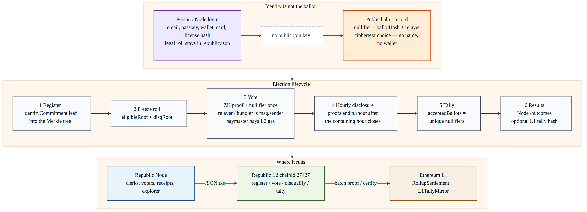

# How voters’ privacy is protected

**NOT FOR PROFIT** — civic public good. Not a commercial product. See [`NOT_FOR_PROFIT.md`](./NOT_FOR_PROFIT.md).

Commander brief for **this tree on `test/unstable`**. It answers: how Republic makes it **impossible, by design, for the public record** to join a voter’s civil / person identity to **what they voted for**, and what observers can see — typically only that a ballot was accepted, and **possibly not even who** (or, until the hour closes, **not even that a ballot exists**).

This is not a sales sheet. If a paragraph disagrees with the contracts or Node code, the code wins.

**As of:** 23 September 2026. **Branch facts:** `test/unstable`.

Related: [`docs/IDENTITY.md`](./docs/IDENTITY.md), [`docs/PASSKEYS.md`](./docs/PASSKEYS.md), [`docs/ARCHITECTURE.md`](./docs/ARCHITECTURE.md), [`docs/BLOCK_EXPLORER.md`](./docs/BLOCK_EXPLORER.md), [`docs/THREAT_MODEL.md`](./docs/THREAT_MODEL.md) (L1 certification / identity spoofing — a different map).

---

## How to read this file

| Label | Meaning |
| --- | --- |
| **Design** | What the public chain, explorer, receipts, and inbox are built so they cannot do. |
| **Demo gap** | What this `test/unstable` build still lets a **Node operator**, reverse proxy, or coerced witness see. Not court-grade. |

The **design** is: civil identity is for **login and the legal roll**. The **ballot** is a ciphertext plus a ZK statement about eligibility and uniqueness. Those two records do not share a public join key. The **demo** still has a Node in the middle that can see more than the public can. Do not confuse the two.

---

## 1. Threat model — what “reveal” means

A privacy failure here is a **join**: someone can say “this named person (or this wallet, this IP, this clerk file row) marked **this option**.” Turnout without a name, or a name without a choice, is not that join.

| Join | What an adversary wants | Public / chain **design** | Residual (who can still do it) |
| --- | --- | --- | --- |
| **Name ↔ choice** | “Jane Doe voted for option 2.” | Vote rows have no name, no `userId`, no option. Receipts are hashes only. The SPA vote POST is an envelope (ciphertext, proof, public inputs, nullifier, election id). | Coercer with an off-chain witness (screenshot, device). A Node that can decrypt the tally ciphertext (`opens_ballots` threshold-1 key) or that is handed a JSON envelope instead of ciphertext. |
| **Wallet ↔ choice** | “This EOA / passkey account marked X.” | Merkle leaf is **not** the wallet. `BallotInbox` has **no voter-address argument**. `VoteAccepted` records the **relayer**, not the voter. | If PRF is skipped and the same secp256k1 key is used as the trapdoor, unlinkability collapses ([`docs/PASSKEYS.md`](./docs/PASSKEYS.md)). Do not ship that. |
| **IP ↔ choice** | Match a kiosk / home IP to a marked ballot. | Inbox and explorer do not store IP. Node access log is method + URL + status, not body or IP ([`apps/node/src/server.mjs`](./apps/node/src/server.mjs)). | TLS terminator, reverse proxy, CDN, or host syslog. Single-relayer timing if operators keep identifying logs next to UserOp hashes. |
| **Clerk DB ↔ choice** | Join the legal file (name, license hash, email) to the marked option. | Public ballot row is `{ nullifier, ballotHash, electionId, relayer }`. `identityLinks` (person ↔ commitment) stay in `republic.json`, not on the vote. `stripBallotPii` drops `userId`, the leaf, wallet ids, and choice keys from the **vote body** and the **proof** object before relay. | Clerk file **does** know person ↔ commitment (the legal roll). The **public** vote does not carry that link. The vote POST does not accept `identityCommitment` or plaintext `answers`. |

**In scope for this brief:** observers, losing candidates, media, and anyone with the explorer or an Ethereum node.

**Out of scope for “impossible”:** a hostile **Node operator** with request bodies, `republic.json`, and envelope storage; a coercer standing over the voter; a threshold-1 tally key on `opens_ballots`. Those are §7.

[`docs/THREAT_MODEL.md`](./docs/THREAT_MODEL.md) covers a different adversary: occupying an L1 result slot, copying UUIDs, spoofing clerks. It is not this ballot-privacy map.

---

## 2. Identity vs ballot separation

Login proves **who is sitting at the desk**. The ballot proves **an eligible secret voted once**. Those secrets are not the same bytes.

Informational map (register → freeze → vote / nullifier / relayer → hourly disclosure → tally → results; Node vs L2 vs L1):



```
Person (Node user)                          Ballot (public / chain)
email, passkey, wallet, card, civic ID      VoteAccepted / explorer vote row
active ETH address (gasless ops only)       nullifier + ballotHash + relayer
identityLinks: userId ↔ commitment          no userId, no name, no wallet
                                            no identityCommitment on the vote
```

| Piece | Job | Must not be |
| --- | --- | --- |
| **Person / passkey / wallet** | Sign in. Email MFA. Vote PIN at submit. Clerk review of cards / licenses. | The Merkle leaf. A public “this address voted.” |
| **Identity commitment (leaf)** | `Hash(trapdoor, nullifierSecret)` inserted at registration. | A wallet address, legal name, credential id, or document number. |
| **Nullifier** | `Hash(nullifierSecret, electionId)` revealed at vote. Spent **once**. | A name. A wallet. A lifetime ban across elections. |
| **Relayer / bundler** | `msg.sender` on `BallotInbox.submitVote`. Paymaster pays L2 gas. | Labeled as the voter. |

**Leaf construction (same idea, three hashers today):**

- Production target: `Poseidon(trapdoor, nullifierSecret)` ([`docs/ARCHITECTURE.md`](./docs/ARCHITECTURE.md), [`circuits/vote.circom`](./circuits/vote.circom)).
- Circom now: gated stand-in `Hasher()` (`standin-v0`) — **not** Poseidon.
- SPA / Foundry tests: `keccak256(trapdoor || nullifierSecret)` ([`IdentityCommitment.sol`](./smart-contracts/src/IdentityCommitment.sol), [`passkey-wallet.js`](./apps/node/public/passkey-wallet.js)).

The leaf is still never the active address. Tests: [`PrivacyUnlinkability.t.sol`](./smart-contracts/test/PrivacyUnlinkability.t.sol).

**Passkey split (design):** WebAuthn PRF → HKDF under **two domains**. Account key authorizes a UserOp. Identity domain yields `(identityTrapdoor, nullifierSecret)`. The trapdoor is zeroed in memory and **never** returned from `authorizeBallot`. Node HTTP stores credential ids, not PRF output.

**Inbox rule:** there is no `submitVote(..., address voter)`. Comment in [`BallotInbox.sol`](./smart-contracts/src/BallotInbox.sol): unlinkability depends on that. Event:

```text
VoteAccepted(electionId indexed, nullifier indexed, ballotHash, relayer)
```

`relayer` is `msg.sender` (bundler). Indexed topics are election id and nullifier only — not a wallet.

**Node relay:** `relayVote` ignores `req.user` / passkey identity when writing the vote. The request is the envelope (`encryptedBallot`, `proof`, `publicInputs`, `nullifier`, election id, `ballotHash`). The leaf is not read and is not persisted ([`apps/node/src/relay.mjs`](./apps/node/src/relay.mjs), [`publicVoteRecord`](./apps/node/src/store.mjs)). `sanitizeVoteBody` drops `answers`, `identityCommitment`, `address`, `credentialId`, and the other banned keys before relay. Open-window roots must still match. Per-leaf exclusion is not decided from this POST, because that would require the leaf on the body. `store.assertCanVote` remains the roll helper for a caller that already holds a commitment.

**Closed:** the SPA does not POST `identityCommitment`, `address`, `credentialId`, or plaintext `answers` ([`buildVoteRequestBody`](./apps/node/public/vote.js)). If an old client still sends them, they are ignored and not stored. Signed-in votes still attach a one-use PIN token and may subscribe that session `userId` to the official outcome PDF (evidence of **having voted**, not of choice).

---

## 3. What is public

Meant to be visible. Process, not preference.

| Object | What observers see | Source |
| --- | --- | --- |
| **Eligibility / freeze roots** | `eligibleRoot`, `disqualificationRoot`, clerk, freeze time. Eligible set is `registered ∩ ¬disqualified`. | Election params, `/explorer`, auditor pack |
| **Registration** | `identityCommitment` hex (leaf). **Never** a legal name. Immediate (not hour-delayed). | `VoterRegistered` / explorer `register` |
| **Nullifiers** | That **this** uniqueness token was spent in election E. One row per nullifier. **After the containing hour closes** on the civic path. | `VoteAccepted`, `GET /api/explorer/nullifiers/:value` |
| **Disqualification** | Commitment, election, **reason code** (e.g. `NOT_RESIDENT`), `evidenceHash`, issuer role, timestamps, revokes. | `DisqualificationRegistry`, explorer |
| **Ballot hashes** | `ballotHash = keccak256(encryptedBallot)` (or the public input bind). Not the option. | Inbox, explorer vote row |
| **Tallies** | Per-option **counts** after a posted tally. IRV **round transcript** (aggregates), not individual rankings. | `TallyPosted`, `/elections/:id/results` |
| **Hourly disclosure** | `lastClosedHourAt`, `acceptedBallotsDisclosed`, `nextPublishAt`. Policy `hourly-polling-place-unlinkability`. Default 3600 s. | [`disclosure.mjs`](./apps/node/src/disclosure.mjs), `GET /api/explorer/disclosure` |
| **Parameters** | Start / cutoff, `ballotSpecHash`, verifier address, `maxParticipants`. | Election record |

**Not a live precinct tick.** Public `acceptedBallots` on Node APIs is the last **closed-hour** snapshot ([`electionState.mjs`](./apps/node/src/electionState.mjs)). Do not publish “N unpublished in election E.”

**On-chain public inputs** for a vote ([`proof-helpers`](./packages/proof-helpers/index.js), `vote.circom`):

`[eligibleRoot, disqRoot, nullifier, ballotHash, electionId]`

Choice bits are **not** in that instance. `disqRoot` is bound so the proof names the live disqualification tree; the circuit still does **not** prove Merkle non-membership of a disqualified leaf (Node JSON path enforces that in software). **Demo gap:** `MockVerifier` accepts any well-shaped proof.

Civic L2 batch `dataHash` includes hashes, roots, nullifiers, reason codes, tally `countsHash` — not ballot plaintext ([`l2/README.md`](./l2/README.md)). If a client sends `choice` / `plaintext`, the sequencer strips it.

---

## 4. What stays private

| Object | Where it lives | Public? |
| --- | --- | --- |
| **Marked options / rankings** | Encrypted envelope. The SPA form does not POST plaintext `answers`. A ciphertext that is still UTF-8 JSON can be decoded into operator `rankingPayload` on ranked envelopes | **No** on explorer, receipts, auditor pack, `/outcomes` during the open window |
| **Civil identity** | Person file: emails, civic-id **hashes**, cards, handles. Legal name / address if the jurisdiction keeps them off-chain | **No** on chain vote. Registration shows commitment only |
| **Trapdoor, nullifier secret, PRF output** | Authenticator / device memory. Zeroed after `authorizeBallot` | **Never** logged by design. Node must not store them |
| **Evidence files** | Clerk / court file. Chain holds `evidenceHash` only | **No**. Hash is public so a court can match a sealed file later |
| **Vote PIN digits** | scrypt hash on the person; scrambled keypad at submit | **No** |
| **Document numbers / passport images** | Not stored. Civic ID is `keccak256(kind\|issuer\|normalizedNumber)` | **No** in `republic.json` |

Explorer must not pretty-print `encryptedBallot` as UTF-8 or as `optionId`. Clerk tools that resolve a commitment to a person file are **back-office**, not `/explorer`.

---

## 5. Nullifiers — uniqueness without naming the person

A nullifier is a **one-time occupancy token** for (this secret, this election). It is not a name.

```text
nullifier = Hash(nullifierSecret, electionId)
```

| Rule | Effect |
| --- | --- |
| Derived from `nullifierSecret` + `electionId` | Different elections → different nullifiers. Not a lifetime ban. |
| Accepted **once** (`NullifierUsed`) | A second `submitVote`, including a **new ciphertext**, reverts. Double voting is impossible. |
| `acceptedBallots` = unique spent nullifiers | Tally `sum(counts)` is a unique-voter invariant. |
| Unlinkable without the secret | Chain data does not map nullifier → wallet or nullifier → civil name. |
| Change of mind | Allowed on the form **before** submit. After accept, no recast (not MACI, not last-vote-counts). |

Voters may change answers privately on `/vote/:id` until they submit. After accept, the inbox will not take a second ballot for that nullifier ([`CoercionResistance.t.sol`](./smart-contracts/test/CoercionResistance.t.sol), [`BallotInbox.sol`](./smart-contracts/src/BallotInbox.sol)).

Without `nullifierSecret` (and the trapdoor that built the leaf), an observer cannot prove which person a nullifier belongs to. With a coerced **witness** (the device still holds the secret, or the voter is forced to reproduce it), that cryptographic unlinkability does not stop an off-chain confession. That is §7.

---

## 6. Encryption / tally path

Choice is not an on-chain plaintext field. How it is hidden **in transit** and **until tally** depends on `tallyScheme`.

### In transit (voter → inbox)

| Scheme | What is posted | Who can open it |
| --- | --- | --- |
| **`opens_ballots`** | `RTv1` \|\| P-256 eph pub \|\| AES-GCM (`p256-ecies-aesgcm-v1`) to the election tally pubkey | Holder of the **threshold-1** private JWK on the Node (`tallyGuardians`). **NON-PRODUCTION.** |
| **`sum_only` (legacy)** | Seed-keyed AES-GCM stand-in (`republic-ballot-elgamal-standin`) when no tally pubkey | In the crypto, the **voter’s wrap seed**. The SPA does **not** also send plaintext `answers`. |
| **EVM calldata** | `encryptedBallot` bytes on `submitVote` | Ciphertext is visible; option is not, unless someone has the opening key |
| **Civic L2 JSON** | Vote tx is `nullifier` + `ballotHash` + roots. Ciphertext omitted from the proof batch | Sequencer may still have seen the submitted JSON |

`ballotHash` binds the ciphertext (`BallotHashMismatch` if they disagree). Public APIs return `publicVoteRecord` without `encryptedBallot`.

### Until / unless `opens_ballots`

| Path | After cutoff | Invented `counts[]` that only match the **sum** |
| --- | --- | --- |
| **`sum_only` (default)** | Operator posts any vector with `sum(counts) == acceptedBallots` | **Accepted** (legacy demo). Operator cannot add or drop ballots; they **can** rearrange which option received them. |
| **`opens_ballots`** | Node decrypts accepted envelopes, derives histogram. `submitOpenedTally` requires `histogram(openings) == counts` | **Rejected** (`INVENTED_COUNTS` / `OpeningMismatch`) |

Opened choices are **not** written back onto public vote rows ([`tallyOpen.mjs`](./apps/node/src/tallyOpen.mjs)). Certified totals appear on `/results` and the official outcome PDF **after** tally — aggregates, not “Jane voted for X.”

**Not done:** Shamir / guardian threshold > 1, mixnet permutation, homomorphic ciphertext product, real Groth16 tally keys, MACI last-vote-counts. Do not run a binding election on the demo key ([`tally-crypto.js`](./apps/node/public/tally-crypto.js) `DEMO_KEY_WARNING`).

---

## 7. Honest limits (critical)

Do **not** tell a court, a legislature, or the public that this `test/unstable` build is production cryptography. The **design** hides choice from the **public record**. The **demo** still trusts the Node host and several stand-ins.

| Gap | What is true today | Why it is not court-grade |
| --- | --- | --- |
| **MockVerifier** | Foundry / local inbox `acceptAll = true`. Dummy proofs in the SPA (`proof.mock: true`). | Anyone who can reach `submitVote` with a fresh nullifier can satisfy the verifier. Eligibility is **Node software** on the JSON path, not a ceremony-backed Groth16. |
| **Stand-in hasher / untrusted ptau** | Circom `Hasher()` is `a+b+a*b`. `npm run circuits:setup` is local powers-of-tau. Poseidon not wired. | Not the production hash. Not a trusted setup. |
| **Passkey helper** | Account is `republic-local-address` (SHA-256 of seed), HMAC UserOp, keccak leaf. | Not secp256k1 / ERC-4337. Fine for UX demos. |
| **SPA vote POST** | Envelope only: ciphertext, proof, public inputs, nullifier, election id, ballot hash, optional `pinToken` and `userOpHash` ([`buildVoteRequestBody`](./apps/node/public/vote.js)). Banned keys are stripped and ignored. | A client that puts the marked ballot in the ciphertext as readable JSON (the ranked JSON demo) still lets the Node decode rankings into `rankingPayload` ([`store.acceptVote`](./apps/node/src/store.mjs)). AES-GCM / ECIES ciphertext does not. The session cookie can still show that a signed-in person voted. |
| **Node operator / `republic.json`** | Person file, `identityLinks`, envelopes (`encryptedBallot`), optional `rankingPayload`, outcome-report subscriptions (`source: vote-default`). `GET .../envelopes` is tally-operator **after cutoff**. | Hostile or sloppy host is a **trust sink** for this demo. Forked Nodes can lie to their own visitors; they cannot occupy another body’s L1 slot ([`THREAT_MODEL.md`](./docs/THREAT_MODEL.md)). |
| **Logs / IP** | App log: `METHOD URL status duration`. No vote-body logger in-tree. | nginx / Caddy / Coolify / AWS ALB access logs, packet capture, and support dumps are **operator policy**. Treat vote POSTs as election-critical. Do not ship identifying logs next to UserOp hashes ([`PASSKEYS.md`](./docs/PASSKEYS.md)). |
| **Single relayer** | JSON path sets `relayer: 'node'`. EVM path uses `RELAYER_PRIVATE_KEY`. All public senders look like the bundler. | Good for wallet unlinkability. Bad for **censorship / liveness** (one key can stall voting). Not a mixnet. |
| **`opens_ballots` key** | Threshold **1**, private JWK on the Node. Never returned by `GET .../tally-key`. | That host **can** decrypt every envelope. Not guardians. |
| **`sum_only`** | Invented partitions of the sum succeed. | Hides **individual** choice from the public; does **not** bind the operator to the real histogram. |
| **Circuit vs disqualification** | `disqRoot` is bound; the open-window `eligibleRoot` must match. The vote POST does not take a leaf, so it does not call `assertCanVote`. The store helper still encodes `registered ∩ ¬disqualified` for the roll. | MockVerifier does not enforce membership. A JSON-path ballot can be accepted without proving the nullifier’s leaf is eligible. No non-membership proof ([README](./README.md) eligibility section). |
| **Coercion / receipts** | Receipt = nullifier, `ballotHash`, UserOp hash, holder token. PDF locked against edit. `receiptsProveChoice: false`. | A coercer who watches the **screen**, copies the device, or demands the **witness** (trapdoor / marked paper) still wins. No last-vote-counts. Not MACI. |
| **Hourly interval `0`** | Tests and local instant demo. | Publishes immediately. Do not use on a public polling place. |
| **EVM `acceptedBallots()`** | Increments **immediately** on `submitVote`. | If BallotInbox is on a **public EVM RPC**, live inbox size / `VoteAccepted` is visible even while the Node explorer still waits for the hour. Civic JSON L2 **seals** vote txs until the hour closes (`eth_getTransactionByHash` → null). Know which path you deployed. |

**What is not yet court-grade (short list):** MockVerifier, stand-in hasher, untrusted ceremony, threshold-1 tally key, JSON-path ballots accepted without a leaf-membership proof, JSON store as roll, no MACI, no production passkey curve, no EVM execution on chainId 27427.

Do not overclaim. A binding public election wants Poseidon + a real Groth16 ceremony + guardians / mixnet + a client that **never** puts choice next to identity on the operator’s HTTP log.

---

## 8. “Possibly not even that he voted”

The public is not entitled to a live “this person just voted” tick. Sometimes they are not entitled to **any** new vote row yet.

### When public rows wait

Votes are **accepted immediately** (nullifier uniqueness). Proof of those votes is public **only after the UTC hour that contained them has closed** (`DISCLOSURE_INTERVAL_SECONDS`, default 3600).

- At 14:23, only events with timestamp **&lt; 14:00** are public. A 14:05 vote appears at **15:00**. A vote **exactly** at 14:00:00 is in the 14:00 hour and appears at 15:00.
- All votes of that hour are lumped into **one** disclosure block. Public timestamp is the **hour boundary**, not 14:03 vs 14:17. Order is **by nullifier**, not arrival ([`explorer.mjs`](./apps/node/src/explorer.mjs), [`l2/disclosure.mjs`](./l2/disclosure.mjs)).
- Unpublished nullifiers and tx hashes **404 like unknown ones**. Do not confirm that a sealed vote exists ([`BLOCK_EXPLORER.md`](./docs/BLOCK_EXPLORER.md)).
- L2 `pending` and `eth_getTransactionByHash` omit sealed votes.

So: a watcher at the polling-place door **cannot** match “that person walked out” to a jurisdiction increment. They also **cannot** look up the nullifier yet. For that hour, the public cannot even see **that a ballot was accepted**.

### Explorer delayed turnout

| Surface | During the open hour | After the hour closes |
| --- | --- | --- |
| `/explorer`, `GET /api/explorer/disclosure` | Last closed hour + countdown. `acceptedBallotsDisclosed` only | Sealed votes flush, ordered by nullifier |
| `GET /api/elections/:id/summary` | Disclosed turnout, no winner | Same + `resultsUrl` only after a certified tally |
| `GET /api/elections/:id/ballots` | Empty / prior hours | `{ nullifier, ballotHash, electionId, relayer }` |
| `/outcomes` while open | Disclosed turnout. **No** unofficial option counts | Certified counts only after tally |
| `/receipt` public hash lookup | 404 until disclosed | Confirms **counted**, still no choice |
| Holder **token** on the receipt | Can confirm **this** ballot counted before the hour closes | Still no option ids |

No dashboard should show “N waiting to publish in election E.” That still names the jurisdiction.

### Observers vs operators

| Actor | Can they see that **a** ballot was accepted (this hour)? | Can they see **who**? | Can they see **what** was marked? |
| --- | --- | --- | --- |
| **Public observer / explorer** | **Not until the hour seals.** Then: a nullifier + hash, not a name. | No (name). Commitment on the **roll** is public; it is not on the vote row. | No |
| **Holder of the receipt token** | Yes, for their ballot, before disclosure | Themselves (they already know) | No (receipt forbids it) |
| **Node / relayer operator** | Yes, immediately (`acceptVote`, inbox `acceptedBallots`) | **Session** can show a signed-in person voted. The vote **body** does not name the leaf or the wallet. **Design of the stored vote row:** no. | **Ciphertext** they can decrypt, or a JSON envelope they can decode (`rankingPayload`). **Not** a plaintext `answers` field on the SPA POST. **Public APIs:** no |
| **Tally operator after cutoff** | Real inbox size (needed for `sum(counts) == acceptedBallots`) | Not from public vote rows | `opens_ballots`: can decrypt. `sum_only`: can invent a partition of the sum |
| **Clerk with the legal file** | Knows who is **registered** (person ↔ commitment) | Yes, for the **roll** | Not from the public ballot. Same Node-host caveat as the operator |

After the hour closes, the public learns **that some eligible secret voted** (a nullifier appeared). They still do not learn **which civil identity** that was, and they do not learn **the option**.

Registration commitments are **not** hour-delayed. Seeing a new leaf means someone was added to the roll — not how they will vote, and not that they have voted.

---

## Commander checklist

- **Tell the public:** choice is not on the explorer; receipts cannot prove “I voted for X”; turnout updates once an hour, after the hour closes.
- **Tell officers:** reason codes are public; evidence files are not; do not build a “voter profile” that lists nullifiers next to a name or passkey address.
- **Tell the host:** vote POST bodies are election-critical; do not log them; do not run `DISCLOSURE_INTERVAL_SECONDS=0` on a public site; do not treat MockVerifier or the tally JWK as production.
- **Do not say:** this build is ready for a binding, court-supervised election.

License: AGPL-3.0-or-later. No token. No paid tier. Voter data is not a product.
