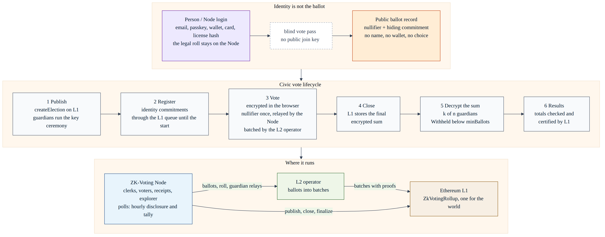

# How voters' privacy is protected

**NOT FOR PROFIT** — civic public good. Not a commercial product. See [`NOT_FOR_PROFIT.md`](./NOT_FOR_PROFIT.md).

A brief for election officials. It answers: how ZK-Voting keeps the public record from joining a
voter's identity to **what they voted for**, what observers can see, and where the limits are.
If a paragraph disagrees with the contracts or the Node code, the code wins.

**As of:** 23 November 2026, branch `rollup-redesign`.

Related: [`IDENTITY.md`](./IDENTITY.md), [`PASSKEYS.md`](./PASSKEYS.md),
[`ARCHITECTURE.md`](./ARCHITECTURE.md), [`THREAT_MODEL.md`](./THREAT_MODEL.md),
[`smart-contracts/docs/ROLLUP.md`](../../smart-contracts/docs/ROLLUP.md).

---

## The short version

| | **Civic vote** | **Poll** |
| --- | --- | --- |
| Who counts it | Ethereum L1 (ZkVotingRollup) | The Node |
| What is ever decrypted | **Only the final per-option sum**, by k of n guardians, checked by L1 | Ballots at tally time (by the Node or, on `opens_ballots` polls, by t guardians) |
| Interim results | None | Hourly turnout; per-choice counts after a turnout gate |
| Small electorate | Below `minBallots` the result is **Withheld**, never decrypted | `RESULTS_MIN_VOTES` gate |
| Privacy | Strongest this system offers | Weaker; the app says so |

A privacy failure is a **join**: someone can say "this named person (or wallet, or IP, or clerk
file row) marked this option." Turnout without a name, or a name without a choice, is not that join.

---

## 1. Identity and ballot are separate records



Signing in proves who is at the keyboard. The ballot proves that an eligible secret voted once.
They are not the same bytes.

```
Person (Node)                                  Ballot
email, passkey, wallet, card, civic ID         civic: nullifier + hiding commitment in L1 pubdata
vote PIN                                       poll:  nullifier + ballot hash in a disclosure block
identity commitment on the roll                no user id, no name, no wallet, no commitment
```

| Piece | Job | Never |
| --- | --- | --- |
| Person, passkey, wallet | Sign in, email MFA, vote PIN | The roll leaf; a public "this address voted" |
| Identity commitment | `Poseidon(trapdoor, nullifierSecret)` on the roll | A wallet address, a name, a document number |
| Nullifier | `Poseidon(nullifierSecret, electionId)`, spent once | A name or wallet; reusable across elections |
| Vote pass | Proves "eligible, has not taken a pass" without saying who | Linkable to the ballot (it is blind-signed) |

The passkey's PRF output is split under two domains: one wraps the account key, the other yields
`(identityTrapdoor, nullifierSecret)`. The trapdoor never leaves the browser.

---

## 2. Casting a ballot

1. **Vote pass.** Signed in, the voter enters their PIN. The Node checks they are on the roll and
   have not taken a pass, records them in the **poll book** (who took part — never which ballot),
   and signs a *blinded* token. The browser unblinds it; the Node never sees the token it signed.
2. **Encrypt.** The browser encrypts one ciphertext per option to the guardians' joint key, with
   proofs that each is 0 or 1 and that they add up to one. The choice never leaves the browser in
   the clear.
3. **Cast.** The browser sends the ballot and the pass **without cookies**. The request carries no
   session, user id or commitment, and the Node does not access-log it. The Node checks the pass
   signature, relays a civic ballot to the L2 operator, and keeps only a receipt.
4. **Receipt.** Hashes only. It cannot prove a choice. A civic receipt follows the ballot to
   "committed" and "executed" on L1.

---

## 3. What is public

| Record | Civic vote | Poll |
| --- | --- | --- |
| The roll | Identity commitments, via L1 priority requests | Roll roots on the Node |
| Disqualifications | Commitment, **reason code**, evidence hash, on L1 | Same, on the Node |
| A ballot | Nullifier + hiding commitment in batch pubdata on L1 | Nullifier + ballot hash in an hourly disclosure block |
| Turnout over time | How many ballots each batch carried | Hourly, after the hour closes plus a delay |
| The result | Final per-option totals, or **Withheld** | Final tally; interim counts after the gate |
| Guardians' work | Key commitments and decryption shares with proofs | Feldman deals and partials (`opens_ballots`) |

Not public: names, emails, documents, wallets on the ballot, IP addresses, the choice on any
single ballot, any partial sum of a civic vote.

---

## 4. Why a single civic ballot cannot be decrypted from public data

- L1 stores ciphertexts only as the election's **accumulator** (the sum of every ballot), and only
  at close. Batch pubdata holds a hiding commitment, not a ciphertext.
- `finalizeResult` is the only decryption: k guardians' shares of the final sum, each with a
  Chaum-Pedersen proof, checked against the ballot count.
- Below `minBallots` nothing is decrypted at all.
- A voter who uses `forceBallot` (to get past a censoring operator) puts their ciphertexts in L1
  calldata; those are protected by the same guardian threshold.

---

## 5. Honest limits

| Limit | What it means |
| --- | --- |
| **No batch circuit yet** | Civic votes settle only on the local test chain today. |
| **Eligibility is the Node's word** | Until the batch circuit proves roll membership, the vote pass is the gate. A hostile Node operator could issue extra passes. It still cannot change a certified result or see a choice. |
| **Operator + k guardians** | The operator holds the ciphertexts. Together with k colluding guardians it could decrypt individual ballots. Choose guardians from independent bodies. |
| **Timing** | Someone watching the Node's live traffic could guess by timing between a vote-pass request and a ballot. The voter can wait, or use another network, before casting. Batch-level turnout is public. |
| **The voter's device** | A coercer standing over the voter, or malware on the device, sees what the voter sees. |
| **Polls** | Counted by the Node; the Node operator, or t guardians on `opens_ballots` polls, can see individual ballots or rankings (not who cast them). |
| **Proxies and logs** | A reverse proxy, CDN or host log that records the `/vote` request can undo the Node's care. See [`OPERATOR.md`](./OPERATOR.md#vote-log-policy-operators-must-enforce). |

---

## 6. Checklist for officials

- Choose guardians from bodies that would not collude, and set k so a minority cannot decrypt
  alone and a majority can still finish.
- Set `minBallots` high enough that a result cannot single out a small group.
- Keep proxy and CDN logs off the `/vote` path.
- Tell voters the receipt cannot show their choice, and that nobody may ask them for it.
- Use a civic vote, not a poll, when ballot secrecy is required.
